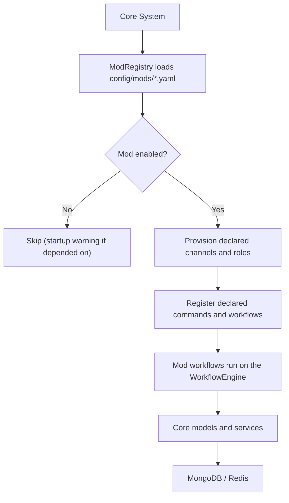

# Mods

BotForge uses a **modular architecture**: each game feature (register, ladder,
clans, ...) is a separate mod built on the generic core. This directory is
where the game designer defines and evolves mod rules and environments —
without coding.

## Mod system overview

A mod is a self-contained feature that:

- declares its configuration in YAML (`botforge-services/config/mods/<mod>.yaml`)
- implements its logic against the generic core (`IPlatform`,
  `WorkflowEngine`, `ChannelService`) — never against a specific platform
- documents its rules and environment here, in `docs/MODS/<mod-name>/`
  (following [TEMPLATE/](TEMPLATE/))

### The standard per-mod doc hierarchy (common to every mod)

Every mod's lore lives in **one place**: `docs/MODS/<mod-name>/`.
The standard file set (copy from `TEMPLATE/` when creating the mod):

| File | Required | Holds |
| ---- | -------- | ----- |
| `README.md` | yes | purpose/concepts + the 5 standard blocks: **channel tree (salons, categories, roles)**, **external-system integration** (game-bound, providers, core seams), **views/buttons/actions of the mod**, **pinned salons**, **player/admin/bot interactions** — see `TEMPLATE/README.md` for the skeleton |
| `RULES.md` | yes | the game rules, written to be automatable/testable |
| `ENVIRONMENT.md` | yes | the environment + season configuration |
| `DECISIONS.md` | recommended | the validated decisions — **they win over everything else** |
| `REFERENCE.md` | when a reference plan exists | the designer's functional reference (moved here from `docs/PLANS/`) |
| `TESTS.md` | yes (shipped behavior) | the test scenarios (`SC-<MOD>-NNN`, Given/When/Then) — each has ONE test in `modules/mods/<mod>/tests/test_scenarios.py`, run by CI and cross-checked by validate_docs |
| `CHANGELOG.md` | optional | the mod's own history |
| any mod-specific file | optional | e.g. kingdoms' `CADASTRE.md`, `PROMISES.md`, `CIVILIZATIONS.md` |

### Mod doc status

| Mod dir | Status | Note |
| ------- | ------ | ---- |
| `kingdoms/` | current | the active mod (Season II reference in `REFERENCE.md`) |
| `pong/` | specified | ascending/descending 1v1 tournament mod on AoE2 (S5 ruleset in `REFERENCE.md`) |
| `TEMPLATE/` | scaffold | copied when creating a new mod |

The old `ladder/` and `register/` doc sets were relics and have been deleted (2026-11-20).

Agents find a mod's lore at `docs/MODS/<mod-name>/` — see the
[mod-lore](../../.agents/skills/mod-lore/SKILL.md) skill for the
load-when-working-on-a-mod rule. A mod with no directory here has no
lore yet: say so and scaffold it from `TEMPLATE/`.

**The lore is alive**: it evolves with the discussions — every decision
taken with the designer updates `docs/MODS/<mod>/` in the same PR as the
code (dated `DECISIONS.md` entry, `RULES.md`/`REFERENCE.md` corrections,
`TESTS.md` scenario when a behavior is fixed; if it was discussed, it is
written). The always-valid session rules live in the agent skills — index
and loading model in [docs/SKILLS/README.md](../SKILLS/README.md) (binding
rule: [docs/CONVENTIONS.md](../CONVENTIONS.md)); a session prompt holds only
what is specific to that session.

#### Game-bound mods

A mod is normally game-agnostic (it may declare `allowed_games`, but its
logic never depends on one game's data). Some mods are **game-bound by
design**: their whole concept targets a single game (e.g. `kingdoms` is
AoE2-only, because its map/civilization meta-game only makes sense there).

A game-bound mod MAY hard-code its game key and game-specific options,
but it MUST NOT own its game data:

- the game catalog (maps, map pools, civilizations) is owned by the core
  `GameDataService` — the mod reads it and never duplicates it
- seasons are registered in the core season registry with a visible, game-scoped id (`<mod>-<game key>-<guild id>-<index>`) — the mod never
  runs its own season numbering
- Discord surfaces (forum topics such as `<game key>-maps` and
  `<game key>-map-pools` in the `games` category) are provisioned by the
  core forum syncs — the mod grafts onto them and never creates them

### How mods integrate with the workflow engine

Multi-step interactions (registration, match reporting) are declared as
workflows and executed by the core `WorkflowEngine`, which persists their
state so flows survive restarts (see
[ADR-0002](../DECISIONS/002-workflow-engine.md)). UI components feed events
back into the running workflow via the `custom_id` convention (see
[architecture/discord.md](../architecture/discord.md)).

### Mod lifecycle

1. **Load**: the bot reads mod declarations (`config/mods/*.yaml`) at startup
2. **Initialize**: enabled mods register their commands and workflows
3. **Execute**: user interactions drive mod workflows
4. **Cleanup**: on shutdown, in-flight workflows are persisted and can resume

### Mod configuration format (YAML)

```yaml
mod:
  name: register
  enabled: true
  settings:
    default_role: "Player"
    admin_notifications: true
    allowed_games:
      - aoe2
      - chess
```

### Extending core functionality

Mods extend the platform by combining core services:

- new workflows → `WorkflowEngine`
- new destinations → `ChannelCategory` via `ChannelService`
- new persistent data → MongoDB models
- new hot state → Redis keys through `StateService`



## Available mods

The repo provides the generic mod tooling: the `config/mods/_example.yaml`
declaration template and the `ModRegistry` (botforge-services#26). Each mod
lands with its own issue, implementation and documentation set.

## Mod catalogue

Every mod — developed, scoped, specified, shaped or a vague idea — is listed
with its maturity level, categories and links in the
[**mod catalogue**](CATALOGUE.md). The catalogue is the game designers'
entry point for browsing and **prioritizing** ideas; the linked issue or doc
holds the decisions. The kingdoms design docs live under [kingdoms/](kingdoms/) — they describe
the target behavior, not shipped code.

## Mod version history

Mod rule and environment changes are tracked per mod (`<mod>/CHANGELOG.md`)
and in the [roadmap](https://github.com/jj-guild/botforge/blob/sync/generated-artifacts/generated/ROADMAP.md).

## See also

- [TEMPLATE/](TEMPLATE/) — template for new mod documentation
- [../WORKFLOWS.md](../WORKFLOWS.md) — user-facing workflow reference
- [../ARCHITECTURE.md](../ARCHITECTURE.md) — core components
