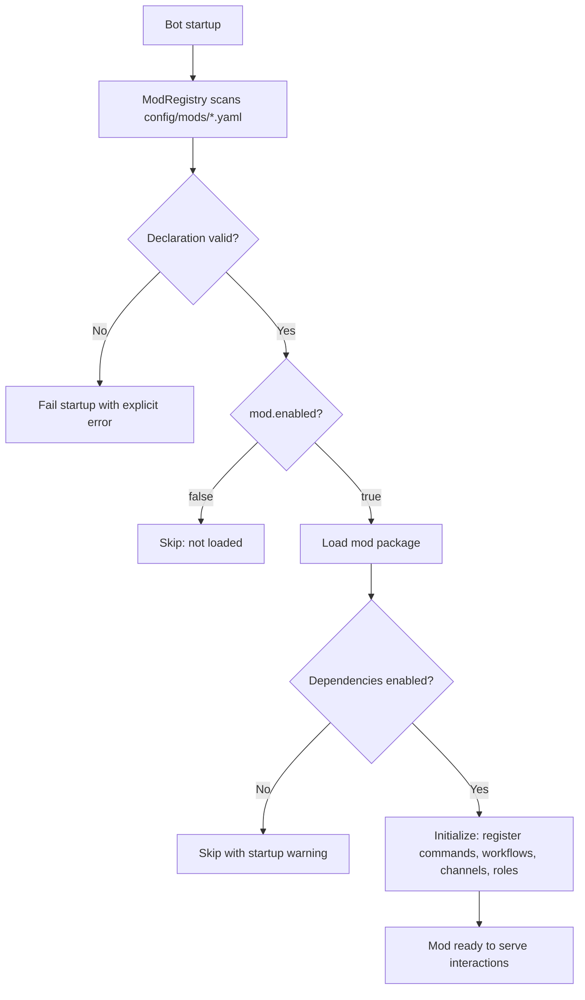

# Mod system design

This page documents the **design** of the mod system: registry, lifecycle,
and extension points. It complements [MODS/README.md](../MODS/README.md),
which stays documentation-facing (how to document a mod, available mods),
and [core.md](core.md), which covers the core services mods build on.

A mod is a self-contained game feature (register, ladder, clans, ...) built
only on the generic core. It never imports platform-specific code, and it
ships with its documentation set in `docs/MODS/<mod-name>/` (see the
[template](../MODS/TEMPLATE/)).

## 1. ModRegistry

`ModRegistry` is the central catalog of installed mods. It does not contain
game logic; it answers "which mods exist, which are enabled, and what do
they declare?".

Responsibilities:

1. **Discovery** — read mod declarations from
   `botforge-services/config/mods/<mod>.yaml` at startup
2. **Enablement** — honor the `enabled` flag; disabled mods are never
   loaded (no commands registered, no workflows, no channels created)
3. **Declaration surface** — expose, per mod:
   - its commands (names and descriptions, i18n keys)
   - its workflows (name → `IWorkflow` implementation)
   - its channel needs (its own channel categories, addressed `mod:key`)
   - its role needs (its own logical role keys, resolved by `RoleService`)
   - its MongoDB collections and Redis key scopes
4. **Dependency awareness** — declare soft dependencies between mods (e.g.
   ladder depends on register for player identity); a disabled dependency
   disables dependents with an explicit startup warning

### Declaration example

The repo ships a fully documented template: `botforge-services/config/mods/_example.yaml`.
Mods are added by copying it as `config/mods/<mod>.yaml` — no core change.

```yaml
# botforge-services/config/mods/<mod>.yaml — schema (validated at startup)
id: example            # simple slug, must match the mod package name
enabled: false         # disabled mods are never loaded
seasonal: false        # MANDATORY mod type: true = season-based (root
                       # lifecycle panel + per-season admin salon),
                       # false = permanent (config panel inside the
                       # mod's guild category). Startup fails without it.
settings: {}           # free-form, mod-specific
channels:              # addressed at runtime as "mod:key"
  - key: announce
    display_name: Annonces
    description: Where the example mod posts announcements
    per_instance: false # true = one channel per instance (e.g. per clan)
roles:                 # logical role keys, resolved by RoleService
  - key: example_member
    display_name: Example Member
    color: 0x99AAB5
    hoisted: false
workflows: []           # workflow names implemented by the mod
commands: []            # command names implemented by the mod
dependencies: []        # mod ids this mod depends on
```

Channel and role declarations are **mod-scoped**: the core never
enumerates mod channels or roles; it only provides the generic services
(`ChannelService`, `RoleService`, `ModRegistry`) that provision them
(botforge-services#26).

`ModRegistry` validates the declaration (schema, known categories, known
locales, resolvable workflow classes) before the mod is loaded; an invalid
declaration fails startup loudly rather than loading a half-initialized mod.



## 2. Mod lifecycle

| Phase | What happens | Failure policy |
| ----- | ------------ | -------------- |
| Discover | `ModRegistry` reads YAML declarations | Invalid YAML/schema → startup error |
| Validate | Schema, categories, locales, workflow classes | Unknown reference → startup error |
| Initialize | Register commands, workflows, channel needs, role needs | Initialization exception → startup error (fail-fast, no half-loaded mod) |
| Execute | Interactions drive mod workflows through `WorkflowEngine` | Runtime errors → user-facing error message, workflow instance left recoverable |
| Persist | In-flight workflows survive as `WorkflowState` | Restart → resume or timeout, never drop |
| Shutdown | Persist state, release locks, unregister | — |

The game-designer-facing summary of this lifecycle lives in
[MODS/README.md](../MODS/README.md#mod-lifecycle).

## 3. Extension points

Mods extend the platform by combining core seams (detailed in
[core.md](core.md#4-extension-points)):

| Need | Extension point | Example |
| ---- | --------------- | ------- |
| New interaction sequence | `IWorkflow` + `WorkflowEngine` | Registration flow |
| New destination | Channel category declared in the mod YAML + `ChannelService` | `example:announce` for announcements |
| New persistent data | MongoDB model | Ladder standings |
| New hot state | `StateService` key scope | Matchmaking queue |
| New user-facing identity | Role declared in mod YAML, resolved by `RoleService` | `player` role |
| New content without code | YAML config (games, locales) | Add a game to `register` |

Anti-patterns (enforced by review, not by code):

- Importing `discord.py` (or any platform package) from mod or core code
- Hardcoding channel IDs, role IDs, or guild IDs
- Extending core enums (`ChannelCategory`, `PlatformType`) with mod-specific values
- Writing raw Redis commands instead of going through `StateService`
- Duplicating another mod's logic instead of depending on it explicitly

## 4. Mod contract

To be loadable, a mod package must provide:

1. A YAML declaration in `botforge-services/config/mods/<mod>.yaml`
   (schema shared with the [template](../../templates/mod-template/))
2. A Python package implementing its workflows against `IWorkflow` and
   calling only core services
3. A documentation set in `botforge/docs/MODS/<mod-name>/`:
   `README.md`, `RULES.md`, `ENVIRONMENT.md` (+ `CHANGELOG.md` when rules
   evolve) — validated by `.github/workflows/scripts/validate_docs.py`
4. Locale entries for every user-facing string in
   `botforge-services/config/locales/{en,fr}.yaml`
   ([ADR-0008](../DECISIONS/008-i18n-system.md))

Mods are wired into Discord as cogs (see
[ARCHITECTURE.md](../ARCHITECTURE.md#3-discord-implementation-botforge-servicessrcbotforgediscord)),
but cogs contain no game logic: they translate platform events into core
calls.

## 5. Mod types and admin surfaces

The mandatory `seasonal` flag selects one of the two `Mod` interface
implementations, and with it the admin surface the core provisions
(lifecycle panel vs guild-level config panel) — detailed, with the
pinned-view and channel-resolution contracts, in
[architecture/channels.md](../architecture/channels.md).

**The core/mods split rule:** mod code stays minimal — a spec
declaration plus thin builders. Reusable UI components and workflow
fillers (maps, pools, seasons, pinned channels, admin panels,
categories, wirings) live in core. Duplicated machinery in a mod is a
factorization bug.

## 6. Testing a mod

Mods are tested through the same seams they use in production: `MockDiscord`
as the `IPlatform` implementation, in-memory stores, and the real
`WorkflowEngine`. A mod that only talks to the core is fully testable
without Discord. Strategy details: [testing.md](testing.md).

## 7. Target layout — one directory per mod (docs / conf / grpc / cogs)

**Developer direction (2026-11-06 session).** The end state of a mod is
a self-contained directory with four concerns — and, at some point, its
own repository. The layout is extraction-ready from day one: no
cross-mod imports, config-relative references only.

```
<mod>/
├── docs/     # the mod's documentation (mirrors docs/MODS/<mod>/)
├── conf/     # declaration YAMLs: channels, panels/menus, locales, providers
├── grpc/     # the mod's gRPC server code (its data, its collections)
└── cogs/     # discord.py cogs: commands, views — call the mod's gRPC
              # service and use the UI SDK; never touch another mod
```

- **The cog is the only Discord layer of a mod**: it declares commands
  and views, calls the mod's gRPC service, and builds its UI through
  the botforge-services UI SDK (the discord-ui skill rules apply
  unchanged).
- **One PyPI artifact per mod** (the cogs package + the gRPC server
  package); the bot Docker image is built **above the published PyPI
  artifacts**, never from source copies.
- **Multi-bot, same image**: the image aggregates the bot core + the
  cogs of every authorized mod; each bot container loads its cogs from
  a `BOTFORGE_MODS` environment variable (comma-separated mod names) at
  startup — at least 3 distinct bots in test and prod, each with a
  different mod set, running the same code.
- Retrofit: the existing game migrates onto this layout and onto the
  mod declaration seam (tracked: botforge-services#310, #311).

## 8. How a mod plugs into the stack (the SDK map)

This section is the operational answer to "what may a mod import, who
does it talk to, where does its data live" — read it before writing mod
code; the [mod-lore](../../.agents/skills/mod-lore/SKILL.md) skill loads
it in every mod session. The rules are enforced by
`tests/architecture/` in botforge-services (R1–R9), not by convention
alone.

### Package layout and import mapping

A §7 mod lives in `modules/mods/<mod>/` in botforge-services:

```
<mod>/
├── conf/            # mod.yaml (salons/roles/commands), views.yaml, locales/{fr,en}.yaml, data/
├── cogs/<mod>/      # the Discord layer — the ONLY place `import discord` is allowed (R6)
├── src/<mod>/       # domain logic — never imports discord, never network
├── grpc/<mod>/      # the service singleton: service() / stack()
└── tests/           # incl. test_scenarios.py (the SC-* scenarios of docs/MODS/<mod>/TESTS.md)
```

`load_mod_package` maps them at runtime: `botforge.mods.<name>`
(= `src/<name>`), `botforge.mods.<name>.cogs` (= `cogs/<name>/`),
`botforge.mods.<name>.grpc` (= `grpc/<name>/`). Clean import:
`from botforge.mods.kingdom.cogs.console import …` — never a sys.path
hack, never the double-nested `cogs.<name>` path.

### Allowed / forbidden imports

| Layer | May import | Must never import |
| ----- | ---------- | ----------------- |
| `cogs/` | `discord`, the `botforge.discord` UI SDK, `botforge.mods.<name>.*` | another mod's package, raw provider clients |
| `src/` (domain) | `botforge.core.*` (models, ids…), its own package | `discord` / `botforge.discord` (R6), network libs (aiohttp/httpx/requests/socket…), any provider internals |
| `grpc/` (service) | its own `src/` + storage, core service contracts | `discord`, network libs |
| `tests/` | the mod's own packages | direct `import discord` lines (R6 scans module tests too) |

### Who the mod talks to, and how

- **Its own service** — through the gRPC singleton:
  `mod_service("<mod>").stack()` / `.service()` (e.g. `stack.kingdoms`,
  `stack.attacks`…). A cog never builds the stack by hand.
- **Core platform services by NAME, via the seams** — `IPlatform`
  (`send_dm`/`edit_dm`/`delete_dm` #407, `create_channel`/`delete_channel`
  #408, `apply_access_policy`…), the workflow engine, the catalog. Never
  by URL, never by another service's internals (R2/R4).
- **External providers (liquipedia, aoe2lobby…)** — they run in their OWN
  processes; the mod reaches them only through the named provider client
  resolved from `EXT_*` env config (R1/R3). Never a hard-coded URL.

### Where the mod reads/writes data

- **MongoDB** — every collection has ONE owner package (R5); the mod
  reads/writes only its own collections, through its own `storage`
  module — never a raw `get_collection` from another layer.
- **Redis** — via the core cache service only; never a direct client.
- **Config** — `conf/mod.yaml` + `conf/*.yaml`; secrets come from env
  vars and never appear in code or commits.
- **Content** — game data (maps, civs) is owned by the core catalog; the
  mod reads it, never duplicates it.

### Isolation and security

Layering R1–R9 is enforced by `tests/architecture/` (a red test = the
agent fixes the import/id, not the human). Discord access is gated by the
channel-tree rules (machine-room, admin-only categories, click-time admin
guards); mod install/uninstall drives the provisioning gate. The mod's
Discord surfaces are declared (`conf/views.yaml`, R9 id contract), wired
(`wire_view`), pinned, i18n'd (fr/en parity) — see the discord-ui skill.

### Lifecycle and tests

Hooks: `register` (sync, at bot build), `setup_hook` (async — boot passes
ride TASKS here; discord.py 2.7 removed `add_listener` and `bot.event`
would override core methods), `close`. Tests: the platform `tests/` plus
the mod's `modules/mods/<mod>/tests/`, including `test_scenarios.py` —
one test per `SC-<MOD>-NNN` scenario of `docs/MODS/<mod>/TESTS.md`, run by
CI and cross-checked by the botforge docs validation.

## See also

- [MODS/README.md](../MODS/README.md) — mod system overview (documentation-facing)
- [core.md](core.md) — core services design
- §8 above — how a mod plugs into the stack (imports, data, seams)
- [ADR-0002](../DECISIONS/002-workflow-engine.md) — workflow engine decision
- [ADR-0008](../DECISIONS/008-i18n-system.md) — i18n decision
