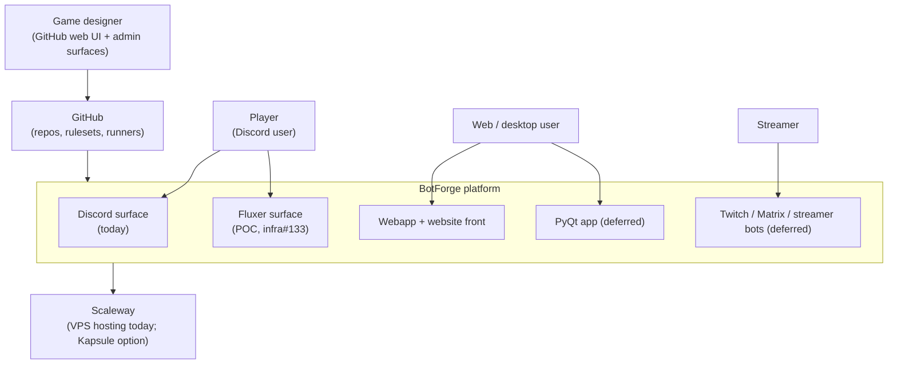
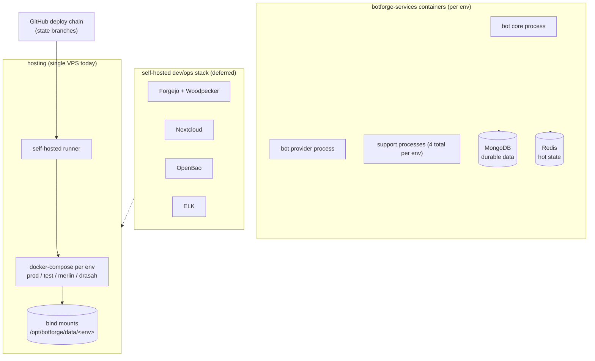
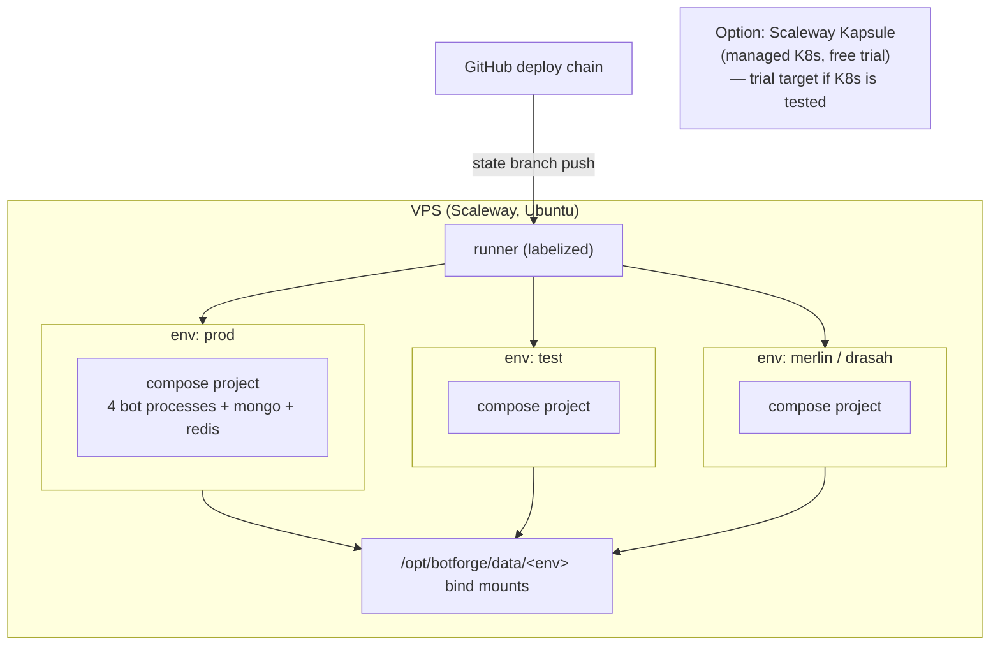
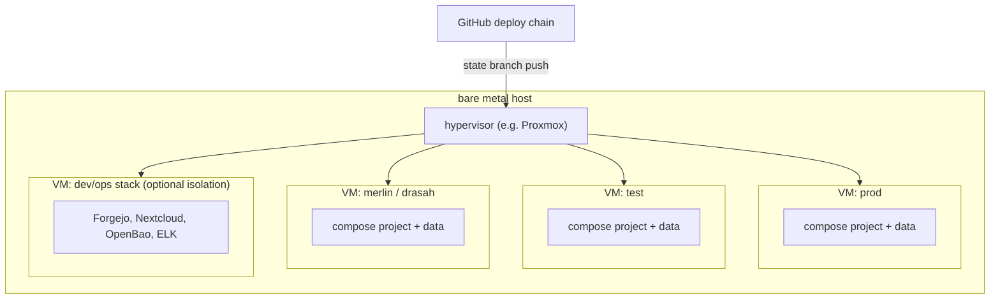

# Topology & C4 diagrams

This page holds the architecture committee's **C4-style diagrams**
(botforge-infra#132): the system context, the containers, and the two
deployment options for the hosting decision (VPS — with the Kapsule
trial — vs bare metal + hypervisor). The vision behind them is
[vision.md](vision.md); the load assumptions are
[capacity.md](capacity.md).

Diagrams are Mermaid, like the rest of the docs. They describe
**target placement**, not implementation detail — the deploy mechanics
live in `botforge-infra` (GITOPS.md, ENVIRONMENTS.md).

## Level 1 — System context

## Level 2 — Containers

## Level 3 — Deployment option A: VPS (incl. Kapsule trial)

The current topology: one VPS, four compose environments, GitOps
reconciliation by a self-hosted runner. Kapsule (managed Kubernetes,
free trial) is an **evaluation option** for the K8s appetite — no
manifest exists today.

## Level 3 — Deployment option B: bare metal + hypervisor

The alternative under evaluation (ADR-022): one physical host, one
hypervisor, environments as isolated VMs — stronger failure domains at
the cost of hardware ownership and ops burden.

## Reading the two options

| Dimension | Option A (VPS + compose) | Option B (bare metal + HV) |
| --- | --- | --- |
| Isolation | compose projects only | VM-level failure domains |
| Ops burden | hoster-managed hardware | we own hardware, power, replacements |
| Cost model | monthly VPS tier(s) | hardware CAPEX + power |
| K8s path | Kapsule trial available | self-managed cluster (heavy) |
| Backup/restore | bind mounts + hoster restore (#338 input) | full VM snapshots + local storage |

The decision path, criteria and current status live in
[ADR-022](../DECISIONS/022-hosting-evaluation-path.md).
