# Dependencies

> Auto-generated by `scripts/sync_dependencies.py`. Do not edit manually:
> edit the `## Dependencies` sections of the issues instead, then
> regenerate this page (see the [Generated artifacts](../.agents/skills/generated-artifacts/SKILL.md) skill).

Source: open issues in [botforge](https://github.com/jj-guild/botforge/issues), [botforge-services](https://github.com/jj-guild/botforge-services/issues) and [botforge-infra](https://github.com/jj-guild/botforge-infra/issues).

Current state and next steps only — the history lives in the git log of
the `sync/generated-artifacts` branch.

Priority labels come from critical-path analysis (CPM):

| Label | Meaning |
| ----- | ------- |
| `priority/P0` | zero slack — on the critical path, any delay delays the project |
| `priority/P1` | slack ≤ 4 pts — near-critical |
| `priority/P2` | slack ≤ 12 pts |
| `priority/P3` | large slack — can be deferred without impact |

Sizes (`size/XS..XL`) map to points (1, 3, 5, 8, 13).

## Critical path

Total: **26 pts**. Critical path:

[botforge#169](https://github.com/jj-guild/botforge/issues/169) -> [botforge#177](https://github.com/jj-guild/botforge/issues/177)

## Next up — wave 0 (no open dependency: actionable now)

| Issue | Lot | Size | Priority |
| ----- | --- | ---- | -------- |
| [botforge-services#321](https://github.com/jj-guild/botforge-services/issues/321) — UX: one uniform pseudo-embed layout (discord-ui skill) — th… | Lot 3 — Kingdoms mod integration (manual, with Drasah) | `M` | `P0` |
| [botforge-services#334](https://github.com/jj-guild/botforge-services/issues/334) — feat(ux): clickable images instead of menu links | Lot 3 — Kingdoms mod integration (manual, with Drasah) | `M` | `P0` |
| [botforge-services#332](https://github.com/jj-guild/botforge-services/issues/332) — feat(visuals): integrate the visual-generator into Kingdoms… | Lot 4 — Mod SDK & pro docs | `M` | `P0` |
| [botforge-services#333](https://github.com/jj-guild/botforge-services/issues/333) — feat(profile): Profile button in every game menu — generic,… | Lot 4 — Mod SDK & pro docs | `M` | `P0` |
| [botforge-services#335](https://github.com/jj-guild/botforge-services/issues/335) — refactor(providers): persist the raw payload, adapt on the… | Lot 4 — Mod SDK & pro docs | `M` | `P0` |
| [botforge-services#336](https://github.com/jj-guild/botforge-services/issues/336) — perf(cache): Redis audit — cold and declarative reads go th… | Lot 4 — Mod SDK & pro docs | `M` | `P0` |
| [botforge-services#337](https://github.com/jj-guild/botforge-services/issues/337) — feat(provisioning): general and discussions channels into t… | Lot 4 — Mod SDK & pro docs | `M` | `P0` |
| [botforge-services#338](https://github.com/jj-guild/botforge-services/issues/338) — infra(volumes): redis (and mongo verified) in bind mounts —… | Lot 4 — Mod SDK & pro docs | `M` | `P0` |
| [botforge-services#120](https://github.com/jj-guild/botforge-services/issues/120) — Implement the automated tournament mod (Epic B, zero-admin… | — | `L` | `P0` |
| [botforge-infra#145](https://github.com/jj-guild/botforge-infra/issues/145) — fix(deploy): prod deploys are dead — the self-hosted runner… | — | `M` | `P0` |
| [botforge-services#362](https://github.com/jj-guild/botforge-services/issues/362) — [Epic] Kingdoms mod on the new main — platform preparation… | Lot 3 — Kingdoms mod integration (manual, with Drasah) | `XL` | `P1` |
| [botforge-services#339](https://github.com/jj-guild/botforge-services/issues/339) — Platform finalization for the kingdoms mod: drasah seam map… | Lot 3 — Kingdoms mod integration (manual, with Drasah) | `L` | `P1` |
| [botforge-services#365](https://github.com/jj-guild/botforge-services/issues/365) — [core+mod] Absorb the duplicated implementations (core+king… | Lot 3 — Kingdoms mod integration (manual, with Drasah) | `L` | `P1` |
| [botforge-services#368](https://github.com/jj-guild/botforge-services/issues/368) — [mod] Kingdoms reimplementation tranches — phased port from… | Lot 3 — Kingdoms mod integration (manual, with Drasah) | `L` | `P1` |
| [botforge-services#363](https://github.com/jj-guild/botforge-services/issues/363) — [core] Home & admin navigation for mods — wire the menu:mod… | Lot 3 — Kingdoms mod integration (manual, with Drasah) | `M` | `P1` |
| [botforge-services#366](https://github.com/jj-guild/botforge-services/issues/366) — [mod] Kingdoms reimplementation skeleton — botforge mod ini… | Lot 3 — Kingdoms mod integration (manual, with Drasah) | `M` | `P1` |
| [botforge-services#367](https://github.com/jj-guild/botforge-services/issues/367) — [mod] Kingdoms mechanism conformance — forum posts, DMs, ep… | Lot 3 — Kingdoms mod integration (manual, with Drasah) | `M` | `P1` |
| [botforge-services#351](https://github.com/jj-guild/botforge-services/issues/351) — feat(registry): the mod & game registry — visibility (priva… | Lot 4 — Mod SDK & pro docs | `XL` | `P1` |
| [botforge-services#353](https://github.com/jj-guild/botforge-services/issues/353) — feat(registry): install/uninstall lifecycle — DM owner appr… | Lot 4 — Mod SDK & pro docs | `L` | `P1` |
| [botforge-services#344](https://github.com/jj-guild/botforge-services/issues/344) — feat(forums): a pinned post per game-data forum (civs/maps/… | Lot 4 — Mod SDK & pro docs | `M` | `P1` |
| [botforge-services#352](https://github.com/jj-guild/botforge-services/issues/352) — feat(registry): visibility levels for mods and games (priva… | Lot 4 — Mod SDK & pro docs | `M` | `P1` |
| [botforge-services#137](https://github.com/jj-guild/botforge-services/issues/137) — [Acceptance] E2E validation vs reference §9 + AoE2 seeding… | Lot 6 — Multi-bot, multi-game, multi-mod | `L` | `P1` |
| [botforge-services#253](https://github.com/jj-guild/botforge-services/issues/253) — [Feature][AoE2] Live match mirror in svc-core — ongoing-gam… | Lot 6 — Multi-bot, multi-game, multi-mod | `L` | `P1` |
| [botforge-services#310](https://github.com/jj-guild/botforge-services/issues/310) — Mod architecture: one directory per mod (docs / conf / grpc… | Lot 6 — Multi-bot, multi-game, multi-mod | `L` | `P1` |
| [botforge-services#315](https://github.com/jj-guild/botforge-services/issues/315) — Providers own their data: per-provider Mongo collections (l… | Lot 7 — Externalized storage & disposable VPS | `M` | `P1` |
| [botforge-services#291](https://github.com/jj-guild/botforge-services/issues/291) — refactor(sdk): the Mongo/Redis access rides the seams — the… | Lot 8 — Pre-1.0.0 review gate (code, DB, architecture, quality) | `L` | `P1` |
| [botforge-services#292](https://github.com/jj-guild/botforge-services/issues/292) — refactor(providers): a registry-driven layer — the bot know… | Lot 8 — Pre-1.0.0 review gate (code, DB, architecture, quality) | `M` | `P1` |
| [botforge-services#309](https://github.com/jj-guild/botforge-services/issues/309) — Architecture guard: land the ADR-0021 AST layering test (R1… | Lot 8 — Pre-1.0.0 review gate (code, DB, architecture, quality) | `M` | `P1` |
| [botforge-services#318](https://github.com/jj-guild/botforge-services/issues/318) — Security & compliance pass: secrets audit, rate-limit harde… | Lot 8 — Pre-1.0.0 review gate (code, DB, architecture, quality) | `M` | `P1` |
| [botforge#169](https://github.com/jj-guild/botforge/issues/169) — [Epic] Mod SDK — factorized high-level platform behaviors,… | — | `XL` | `P1` |
| [botforge-services#156](https://github.com/jj-guild/botforge-services/issues/156) — [Kingdoms T1] Mod foundations — module, season config, King… | — | `XL` | `P1` |
| [botforge-services#157](https://github.com/jj-guild/botforge-services/issues/157) — [Kingdoms T2] Season & enrollment — admin launch, reset, Ki… | — | `XL` | `P1` |
| [botforge-services#158](https://github.com/jj-guild/botforge-services/issues/158) — [Kingdoms T4] Attacks & defenses — state machine, delays, w… | — | `XL` | `P1` |
| [botforge-services#159](https://github.com/jj-guild/botforge-services/issues/159) — [Kingdoms T5] Weekly events — ages, Lord's Day (+Gaïa maps,… | — | `XL` | `P1` |
| [botforge-services#160](https://github.com/jj-guild/botforge-services/issues/160) — [Kingdoms T6] Diplomacy & marriages — civilization conditio… | — | `XL` | `P1` |
| [botforge-services#161](https://github.com/jj-guild/botforge-services/issues/161) — [Kingdoms T7] Economic technologies — tech currency, Explor… | — | `XL` | `P1` |
| [botforge-services#162](https://github.com/jj-guild/botforge-services/issues/162) — [Kingdoms T8] Season end — Conquest victory, tie ShowMatch… | — | `XL` | `P1` |
| [botforge-services#163](https://github.com/jj-guild/botforge-services/issues/163) — [Kingdoms T3] Territories & maps — allowed map catalog, dra… | — | `XL` | `P1` |
| [botforge#170](https://github.com/jj-guild/botforge/issues/170) — [Epic] Public PyPI packages & service versioning — clean pa… | — | `L` | `P1` |
| [botforge-infra#127](https://github.com/jj-guild/botforge-infra/issues/127) — Externalize MongoDB & Redis to the managed clusters + backu… | — | `L` | `P1` |
| [botforge-infra#89](https://github.com/jj-guild/botforge-infra/issues/89) — Deploy 4 processes (bot-discord, svc-core, ext-librematch,… | — | `L` | `P1` |
| [botforge#197](https://github.com/jj-guild/botforge/issues/197) — [Docs] Pre-1.0 reconciliation: enforcement claims match rea… | — | `M` | `P1` |
| [botforge-services#380](https://github.com/jj-guild/botforge-services/issues/380) — core: the menu/panel template set — the types kingdoms uses… | — | `M` | `P1` |
| [botforge-services#381](https://github.com/jj-guild/botforge-services/issues/381) — frame: the kingdoms mod dir is self-contained — commits eve… | — | `M` | `P1` |
| [botforge#134](https://github.com/jj-guild/botforge/issues/134) — ci: CLA check does not re-run on /cla comment | — | `S` | `P1` |
| [botforge-services#393](https://github.com/jj-guild/botforge-services/issues/393) — feat(sdk): the operator's tools are ALWAYS LAST — the admin… | — | `S` | `P1` |
| [botforge-services#369](https://github.com/jj-guild/botforge-services/issues/369) — [mod] Kingdoms season-2 game-design backlog — taverne tranc… | Lot 3 — Kingdoms mod integration (manual, with Drasah) | `L` | `P2` |
| [botforge-services#348](https://github.com/jj-guild/botforge-services/issues/348) — Map types: let users enter and edit the classification (ope… | Lot 3 — Kingdoms mod integration (manual, with Drasah) | `M` | `P2` |
| [botforge-services#343](https://github.com/jj-guild/botforge-services/issues/343) — feat(pools): pool post member maps as a reusable Components… | Lot 3 — Kingdoms mod integration (manual, with Drasah) | `S` | `P2` |
| [botforge-services#360](https://github.com/jj-guild/botforge-services/issues/360) — Static views (pins) must refresh when the deployed version… | Lot 3 — Kingdoms mod integration (manual, with Drasah) | `S` | `P2` |
| [botforge-services#354](https://github.com/jj-guild/botforge-services/issues/354) — feat(registry): dependency resolution — mods requiring mods… | Lot 4 — Mod SDK & pro docs | `M` | `P2` |
| [botforge-services#314](https://github.com/jj-guild/botforge-services/issues/314) — Human-without-agent walkthrough: the documented contributio… | Lot 4 — Mod SDK & pro docs | `S` | `P2` |
| [botforge-services#329](https://github.com/jj-guild/botforge-services/issues/329) — Public container registry: choice + dual-registry publish p… | Lot 5 — Packaging (PyPI + registries) | `M` | `P2` |
| [botforge-services#324](https://github.com/jj-guild/botforge-services/issues/324) — Visual generator: customizable visuals (external lib) + in-… | Lot 6 — Multi-bot, multi-game, multi-mod | `L` | `P2` |
| [botforge-services#325](https://github.com/jj-guild/botforge-services/issues/325) — Ladder mod integration (optional before 1.0.0) — the agent-… | Lot 6 — Multi-bot, multi-game, multi-mod | `L` | `P2` |
| [botforge-services#227](https://github.com/jj-guild/botforge-services/issues/227) — Refactor: declare the bot's dynamic attributes (eliminate f… | Lot 8 — Pre-1.0.0 review gate (code, DB, architecture, quality) | `M` | `P2` |
| [botforge-services#273](https://github.com/jj-guild/botforge-services/issues/273) — Dead-code audit: every view/embed/message must trace to VIE… | Lot 8 — Pre-1.0.0 review gate (code, DB, architecture, quality) | `M` | `P2` |
| [botforge-services#289](https://github.com/jj-guild/botforge-services/issues/289) — i18n: the hardcoded French strings across the Discord surfa… | Lot 8 — Pre-1.0.0 review gate (code, DB, architecture, quality) | `M` | `P2` |
| [botforge-services#317](https://github.com/jj-guild/botforge-services/issues/317) — Public release comms: landing page, announcement, public do… | Lot 8 — Pre-1.0.0 review gate (code, DB, architecture, quality) | `M` | `P2` |
| [botforge-services#319](https://github.com/jj-guild/botforge-services/issues/319) — First external contributors onboarded through the public do… | Lot 8 — Pre-1.0.0 review gate (code, DB, architecture, quality) | `M` | `P2` |
| [botforge-services#293](https://github.com/jj-guild/botforge-services/issues/293) — refactor(games): the game keys ride config — no 'aoe2' lite… | Lot 8 — Pre-1.0.0 review gate (code, DB, architecture, quality) | `S` | `P2` |
| [botforge-services#350](https://github.com/jj-guild/botforge-services/issues/350) — [Post-rename] The resource-post SDK: one abstraction for ev… | — | `XL` | `P2` |
| [botforge-services#395](https://github.com/jj-guild/botforge-services/issues/395) — [Feature] Generalize the Jinja card templating: every view… | — | `L` | `P2` |
| [botforge#129](https://github.com/jj-guild/botforge/issues/129) — Mod Kingdoms — méta-jeu de conquête AoE2 (Saison II) : docu… | — | `M` | `P2` |
| [botforge#173](https://github.com/jj-guild/botforge/issues/173) — [Epic] Contributor journeys — documented playbooks: bugfix,… | — | `M` | `P2` |
| [botforge-infra#90](https://github.com/jj-guild/botforge-infra/issues/90) — Cross-process observability — correlation ids, dashboards,… | — | `M` | `P2` |
| [botforge-services#19](https://github.com/jj-guild/botforge-services/issues/19) — [Phase 3] Implement clans mod | — | `M` | `P2` |
| [botforge-services#397](https://github.com/jj-guild/botforge-services/issues/397) — External battery flaky: Liquipedia 429 on the maps-query-sh… | — | `S` | `P2` |
| [botforge-services#267](https://github.com/jj-guild/botforge-services/issues/267) — mods-init platform — enrollment + criteria, per-mod seasons… | Lot 3 — Kingdoms mod integration (manual, with Drasah) | `XL` | `P3` |
| [botforge-services#326](https://github.com/jj-guild/botforge-services/issues/326) — mods-init deliverable: test-env validation, companions, mer… | Lot 3 — Kingdoms mod integration (manual, with Drasah) | `M` | `P3` |
| [botforge-services#328](https://github.com/jj-guild/botforge-services/issues/328) — Mod platform backlog: mod-level map pool, bound-games gate,… | Lot 4 — Mod SDK & pro docs | `L` | `P3` |
| [botforge-services#349](https://github.com/jj-guild/botforge-services/issues/349) — Task: local CLI (vpsctl) to install, diagnose and operate t… | Lot 4 — Mod SDK & pro docs | `M` | `P3` |
| [botforge-services#269](https://github.com/jj-guild/botforge-services/issues/269) — [Epic] Mod management — seasonal/permanent mods, staff role… | Lot 6 — Multi-bot, multi-game, multi-mod | `XL` | `P3` |
| [botforge-services#271](https://github.com/jj-guild/botforge-services/issues/271) — [Epic] AoE2 data management — Libre:Match + aoe2lobby provi… | Lot 6 — Multi-bot, multi-game, multi-mod | `XL` | `P3` |
| [botforge-services#272](https://github.com/jj-guild/botforge-services/issues/272) — [Epic] Dev console — clean test guild, clean DB, install mo… | Lot 6 — Multi-bot, multi-game, multi-mod | `XL` | `P3` |
| [botforge-services#279](https://github.com/jj-guild/botforge-services/issues/279) — feat(aoe2lobby): hardening the integration — realtime delta… | Lot 6 — Multi-bot, multi-game, multi-mod | `XL` | `P3` |
| [botforge-services#204](https://github.com/jj-guild/botforge-services/issues/204) — [Epic] /admin data — extensible admin data menu (core, mods… | Lot 6 — Multi-bot, multi-game, multi-mod | `L` | `P3` |
| [botforge-services#266](https://github.com/jj-guild/botforge-services/issues/266) — Visual cards: rebranch builders on entity_card + ADR (tripl… | Lot 6 — Multi-bot, multi-game, multi-mod | `L` | `P3` |
| [botforge-services#268](https://github.com/jj-guild/botforge-services/issues/268) — [Epic] YAML-driven menus — pin channels, permissions, roles… | Lot 6 — Multi-bot, multi-game, multi-mod | `L` | `P3` |
| [botforge-services#288](https://github.com/jj-guild/botforge-services/issues/288) — feat(aoe2): the remaining libre:match endpoints (leaderboar… | Lot 6 — Multi-bot, multi-game, multi-mod | `L` | `P3` |
| [botforge-services#203](https://github.com/jj-guild/botforge-services/issues/203) — Map versions — game-owned map catalog with version pinning… | Lot 6 — Multi-bot, multi-game, multi-mod | `M` | `P3` |
| [botforge-services#287](https://github.com/jj-guild/botforge-services/issues/287) — feat(aoe2): load the real leaderboard mappings (GetAvailabl… | Lot 6 — Multi-bot, multi-game, multi-mod | `M` | `P3` |
| [botforge-services#58](https://github.com/jj-guild/botforge-services/issues/58) — Sub-task: On-demand role & channel sync (admin command, ide… | Lot 6 — Multi-bot, multi-game, multi-mod | `M` | `P3` |
| [botforge-services#187](https://github.com/jj-guild/botforge-services/issues/187) — [Epic] v1.0.0 Public release | Lot 8 — Pre-1.0.0 review gate (code, DB, architecture, quality) | `XL` | `P3` |
| [botforge-services#154](https://github.com/jj-guild/botforge-services/issues/154) — [Task] App verification readiness: privacy policy, terms of… | Lot 8 — Pre-1.0.0 review gate (code, DB, architecture, quality) | `M` | `P3` |
| [botforge-services#202](https://github.com/jj-guild/botforge-services/issues/202) — [Task] CLI triage — prune or repoint commands made stale by… | Lot 8 — Pre-1.0.0 review gate (code, DB, architecture, quality) | `S` | `P3` |
| [botforge#110](https://github.com/jj-guild/botforge/issues/110) — Epic A: Core domain (players, seasons, matches, scoring, en… | — | `XL` | `P3` |
| [botforge#111](https://github.com/jj-guild/botforge/issues/111) — Epic B: Tournament machine (sign-ups, seeding, brackets, di… | — | `XL` | `P3` |
| [botforge#115](https://github.com/jj-guild/botforge/issues/115) — Epic F: Team maker (LFG tickets, balanced teams, captain dr… | — | `XL` | `P3` |
| [botforge#118](https://github.com/jj-guild/botforge/issues/118) — Epic J: Social & moderation (friends, private feedback, san… | — | `XL` | `P3` |
| [botforge#136](https://github.com/jj-guild/botforge/issues/136) — [Epic K] Vibe-coding mod platform — assisted, UI-based mod… | — | `XL` | `P3` |
| [botforge#141](https://github.com/jj-guild/botforge/issues/141) — [Epic L] Contributor spaces — personal branches, personal t… | — | `XL` | `P3` |
| [botforge#187](https://github.com/jj-guild/botforge/issues/187) — Visual engine library — generalize TCG card generation into… | — | `XL` | `P3` |
| [botforge-infra#95](https://github.com/jj-guild/botforge-infra/issues/95) — Multi-tenant GitOps — personal envs (test-<user>), prod slo… | — | `XL` | `P3` |
| [botforge-services#214](https://github.com/jj-guild/botforge-services/issues/214) — [Epic] Gestion-saison — panel admin de gouvernance live (Se… | — | `XL` | `P3` |
| [botforge#112](https://github.com/jj-guild/botforge/issues/112) — Epic C: Game data & drafts (maps, mappools, civs, DraftProv… | — | `L` | `P3` |
| [botforge#113](https://github.com/jj-guild/botforge/issues/113) — Epic D: Ratings & stars (Glicko-2, history, badges) | — | `L` | `P3` |
| [botforge#114](https://github.com/jj-guild/botforge/issues/114) — Epic E: Presence (real-time availability) | — | `L` | `P3` |
| [botforge#171](https://github.com/jj-guild/botforge/issues/171) — [Epic] Per-service DB accounts — enforced core/games/mods p… | — | `L` | `P3` |
| [botforge#172](https://github.com/jj-guild/botforge/issues/172) — [Epic] Non-Discord data access — exportable guild configs,… | — | `L` | `P3` |
| [botforge-services#175](https://github.com/jj-guild/botforge-services/issues/175) — [Task] Fix first designer-session drifts: core-owned provis… | — | `L` | `P3` |
| [botforge-services#216](https://github.com/jj-guild/botforge-services/issues/216) — Tranche ① — Structure Discord : 11 catégories + salons par… | — | `L` | `P3` |
| [botforge#109](https://github.com/jj-guild/botforge/issues/109) — [Docs] Product plan — living document (vision, phases 0-4,… | — | `M` | `P3` |
| [botforge#138](https://github.com/jj-guild/botforge/issues/138) — Design: architecture Discord salons-first du mod Kingdoms (… | — | `M` | `P3` |
| [botforge#143](https://github.com/jj-guild/botforge/issues/143) — [Task] Factorize the shared check workflows (CLA, auto-tria… | — | `M` | `P3` |
| [botforge#155](https://github.com/jj-guild/botforge/issues/155) — Hygiène branches/PRs Drasah : renommage vibe/*, restack, do… | — | `M` | `P3` |
| [botforge-infra#107](https://github.com/jj-guild/botforge-infra/issues/107) — P1: SimCord journeys exit 128 when the pinned deploy_commit… | — | `M` | `P3` |
| [botforge-infra#111](https://github.com/jj-guild/botforge-infra/issues/111) — [v0.5.0] Docker Hub rate limits break the builds — mirror t… | — | `M` | `P3` |
| [botforge-infra#116](https://github.com/jj-guild/botforge-infra/issues/116) — Bot down après reset de token : crash-loop de restart sur L… | — | `M` | `P3` |
| [botforge-infra#128](https://github.com/jj-guild/botforge-infra/issues/128) — env-console.yml + per-env TEST_GUILD_IDS — the dev console'… | — | `M` | `P3` |
| [botforge-infra#5](https://github.com/jj-guild/botforge-infra/issues/5) — [Phase 2] Configure monitoring | — | `M` | `P3` |
| [botforge-infra#96](https://github.com/jj-guild/botforge-infra/issues/96) — [Task] Silent rollback — re-pin without re-deploying when t… | — | `M` | `P3` |
| [botforge-services#199](https://github.com/jj-guild/botforge-services/issues/199) — [Task] CLI mode awareness — sandbox / pro / cowboy guardrai… | — | `M` | `P3` |
| [botforge-services#201](https://github.com/jj-guild/botforge-services/issues/201) — [Task] kingdoms env — personal environment companion (show,… | — | `M` | `P3` |
| [botforge-services#219](https://github.com/jj-guild/botforge-services/issues/219) — Tranche ② — panels d'état des salons royaume (hors Salle du… | — | `M` | `P3` |
| [botforge-services#232](https://github.com/jj-guild/botforge-services/issues/232) — [Kingdoms] Phase 1.1 — salon gestion-saison + tableau de bo… | — | `M` | `P3` |
| [botforge-services#396](https://github.com/jj-guild/botforge-services/issues/396) — [Feature] Announcements through the templating mechanism on… | — | `M` | `P3` |
| [botforge#151](https://github.com/jj-guild/botforge/issues/151) — Assign owners for the orphan mods (ladder, register) — owne… | — | `S` | `P3` |
| [botforge#152](https://github.com/jj-guild/botforge/issues/152) — Drifts de session Drasah : mod marriage hors process, branc… | — | `S` | `P3` |
| [botforge#154](https://github.com/jj-guild/botforge/issues/154) — Mod kingdoms : replier le travail marriage dans le mod king… | — | `S` | `P3` |
| [botforge#156](https://github.com/jj-guild/botforge/issues/156) — Rétrospective : pourquoi Drasah s'est bloqué (pile de PRs,… | — | `S` | `P3` |
| [botforge#202](https://github.com/jj-guild/botforge/issues/202) — Branch naming rules — review vibe/<user>/main in favor of p… | — | `S` | `P3` |
| [botforge-infra#122](https://github.com/jj-guild/botforge-infra/issues/122) — fix(envlogs): the --service filter rejects botforge-ext-aoe… | — | `S` | `P3` |
| [botforge-infra#124](https://github.com/jj-guild/botforge-infra/issues/124) — chore(deploy): the deploy/logs/seed workflows must not noti… | — | `S` | `P3` |
| [botforge-infra#94](https://github.com/jj-guild/botforge-infra/issues/94) — TEST: KingdomsService non monté au démarrage du bot (« no s… | — | `S` | `P3` |
| [botforge-services#148](https://github.com/jj-guild/botforge-services/issues/148) — Add /drasah medieval greeting command | — | `S` | `P3` |
| [botforge-services#20](https://github.com/jj-guild/botforge-services/issues/20) — [Phase 1] Create deployment scripts | — | `S` | `P3` |
| [botforge-services#200](https://github.com/jj-guild/botforge-services/issues/200) — [Task] botforge branch — print-only helper for the user bra… | — | `S` | `P3` |
| [botforge-services#286](https://github.com/jj-guild/botforge-services/issues/286) — chambre-des-comptes: le bouton ne répond plus sur drasah (v… | — | `S` | `P3` |
| [botforge-services#392](https://github.com/jj-guild/botforge-services/issues/392) — chore(deps): revisit pynacl when discord.py allows >= 1.6.2… | — | `S` | `P3` |

## Dependency graph

```mermaid
flowchart LR
    subgraph MSG0['Lot 3 — Kingdoms mod integration']
        direction LR
        ks_267["#267 mods-init platform"]
        ks_321["#321 UX: one uniform pseudo-embed layout"]
        ks_326["#326 mods-init deliverable: test-env validat…"]
        ks_334["#334 feat(ux): clickable images instead of m…"]
        ks_339["#339 Platform finalization for the kingdoms…"]
        ks_343["#343 feat(pools): pool post member maps as a…"]
        ks_348["#348 Map types: let users enter and edit the…"]
        ks_360["#360 Static views"]
        ks_362["#362 [Epic] Kingdoms mod on the new main"]
        ks_363["#363 [core] Home & admin navigation for mods"]
        ks_365["#365 [core+mod] Absorb the duplicated implem…"]
        ks_366["#366 [mod] Kingdoms reimplementation skeleton"]
        ks_367["#367 [mod] Kingdoms mechanism conformance"]
        ks_368["#368 [mod] Kingdoms reimplementation tranches"]
        ks_369["#369 [mod] Kingdoms season-2 game-design bac…"]
    end
    subgraph MSG1['Lot 4 — Mod SDK & pro docs']
        direction LR
        ks_314["#314 Human-without-agent walkthrough: the do…"]
        ks_328["#328 Mod platform backlog: mod-level map poo…"]
        ks_332["#332 feat(visuals): integrate the visual-gen…"]
        ks_333["#333 feat(profile): Profile button in every…"]
        ks_335["#335 refactor(providers): persist the raw pa…"]
        ks_336["#336 perf(cache): Redis audit"]
        ks_337["#337 feat(provisioning): general and discuss…"]
        ks_338["#338 infra(volumes): redis"]
        ks_344["#344 feat(forums): a pinned post per game-da…"]
        ks_349["#349 Task: local CLI"]
        ks_351["#351 feat(registry): the mod & game registry"]
        ks_352["#352 feat(registry): visibility levels for m…"]
        ks_353["#353 feat(registry): install/uninstall lifec…"]
        ks_354["#354 feat(registry): dependency resolution"]
    end
    subgraph MSG2['Lot 5 — Packaging']
        direction LR
        ks_329["#329 Public container registry: choice + dua…"]
    end
    subgraph MSG3['Lot 6 — Multi-bot, multi-game, multi-mod']
        direction LR
        ks_58["#58 Sub-task: On-demand role & channel sync"]
        ks_137["#137 [Acceptance] E2E validation vs referenc…"]
        ks_203["#203 Map versions"]
        ks_204["#204 [Epic] /admin data"]
        ks_253["#253 [Feature][AoE2] Live match mirror in sv…"]
        ks_266["#266 Visual cards: rebranch builders on enti…"]
        ks_268["#268 [Epic] YAML-driven menus"]
        ks_269["#269 [Epic] Mod management"]
        ks_271["#271 [Epic] AoE2 data management"]
        ks_272["#272 [Epic] Dev console"]
        ks_279["#279 feat(aoe2lobby): hardening the integrat…"]
        ks_287["#287 feat(aoe2): load the real leaderboard m…"]
        ks_288["#288 feat(aoe2): the remaining libre:match e…"]
        ks_310["#310 Mod architecture: one directory per mod"]
        ks_311["#311 Multi-bot: same image, env-activated co…"]
        ks_324["#324 Visual generator: customizable visuals"]
        ks_325["#325 Ladder mod integration"]
    end
    subgraph MSG4['Lot 7 — Externalized storage & disposable VPS']
        direction LR
        ks_281["#281 infra(db): one Mongo account per service"]
        ks_315["#315 Providers own their data: per-provider…"]
    end
    subgraph MSG5['Lot 8 — Pre-1.0.0 review gate']
        direction LR
        ks_154["#154 [Task] App verification readiness: priv…"]
        ks_187["#187 [Epic] v1.0.0 Public release"]
        ks_202["#202 [Task] CLI triage"]
        ks_227["#227 Refactor: declare the bot's dynamic att…"]
        ks_273["#273 Dead-code audit: every view/embed/messa…"]
        ks_289["#289 i18n: the hardcoded French strings acro…"]
        ks_291["#291 refactor(sdk): the Mongo/Redis access r…"]
        ks_292["#292 refactor(providers): a registry-driven…"]
        ks_293["#293 refactor(games): the game keys ride con…"]
        ks_309["#309 Architecture guard: land the ADR-0021 A…"]
        ks_312["#312 Conf-over-code retrofit audit: every de…"]
        ks_313["#313 Test perimeter audit: full coverage mat…"]
        ks_317["#317 Public release comms: landing page, ann…"]
        ks_318["#318 Security & compliance pass: secrets aud…"]
        ks_319["#319 First external contributors onboarded t…"]
        ks_320["#320 Pre-1.0.0 review gate: code + database…"]
    end
    subgraph MSG6['No milestone yet']
        direction LR
        ki_5["#5 [Phase 2] Configure monitoring"]
        ks_19["#19 [Phase 3] Implement clans mod"]
        ks_20["#20 [Phase 1] Create deployment scripts"]
        ks_21["#21 [Phase 3] Implement admin mod"]
        ki_89["#89 Deploy 4 processes"]
        ki_90["#90 Cross-process observability"]
        ki_94["#94 TEST: KingdomsService non monté au déma…"]
        ki_95["#95 Multi-tenant GitOps"]
        ki_96["#96 [Task] Silent rollback"]
        ki_107["#107 P1: SimCord journeys exit 128 when the…"]
        k_109["#109 [Docs] Product plan"]
        k_110["#110 Epic A: Core domain"]
        k_111["#111 Epic B: Tournament machine"]
        ki_111["#111 [v0.5.0] Docker Hub rate limits break t…"]
        k_112["#112 Epic C: Game data & drafts"]
        k_113["#113 Epic D: Ratings & stars"]
        k_114["#114 Epic E: Presence"]
        k_115["#115 Epic F: Team maker"]
        ki_116["#116 Bot down après reset de token : crash-l…"]
        k_118["#118 Epic J: Social & moderation"]
        ks_120["#120 Implement the automated tournament mod"]
        ks_121["#121 Full-auto tournament mode"]
        ki_122["#122 fix(envlogs): the --service filter reje…"]
        ki_124["#124 chore(deploy): the deploy/logs/seed wor…"]
        ki_127["#127 Externalize MongoDB & Redis to the mana…"]
        ki_128["#128 env-console.yml + per-env TEST_GUILD_IDS"]
        k_129["#129 Mod Kingdoms"]
        k_134["#134 ci: CLA check does not re-run on /cla c…"]
        k_136["#136 [Epic K] Vibe-coding mod platform"]
        k_138["#138 Design: architecture Discord salons-fir…"]
        k_141["#141 [Epic L] Contributor spaces"]
        k_143["#143 [Task] Factorize the shared check workf…"]
        ki_145["#145 fix(deploy): prod deploys are dead"]
        ks_148["#148 Add /drasah medieval greeting command"]
        k_151["#151 Assign owners for the orphan mods"]
        k_152["#152 Drifts de session Drasah : mod marriage…"]
        k_154["#154 Mod kingdoms : replier le travail marri…"]
        k_155["#155 Hygiène branches/PRs Drasah : renommage…"]
        k_156["#156 Rétrospective : pourquoi Drasah s'est b…"]
        ks_156["#156 [Kingdoms T1] Mod foundations"]
        ks_157["#157 [Kingdoms T2] Season & enrollment"]
        ks_158["#158 [Kingdoms T4] Attacks & defenses"]
        ks_159["#159 [Kingdoms T5] Weekly events"]
        ks_160["#160 [Kingdoms T6] Diplomacy & marriages"]
        ks_161["#161 [Kingdoms T7] Economic technologies"]
        ks_162["#162 [Kingdoms T8] Season end"]
        ks_163["#163 [Kingdoms T3] Territories & maps"]
        k_169["#169 [Epic] Mod SDK"]
        k_170["#170 [Epic] Public PyPI packages & service v…"]
        k_171["#171 [Epic] Per-service DB accounts"]
        k_172["#172 [Epic] Non-Discord data access"]
        k_173["#173 [Epic] Contributor journeys"]
        k_174["#174 [Epic] Pre-1.0 content bar"]
        ks_175["#175 [Task] Fix first designer-session drift…"]
        k_177["#177 [Epic v1.0.0] Generic platform systems"]
        k_178["#178 [Epic v1.0.0] Mod contract"]
        k_179["#179 [Epic v1.0.0] Modular repo layout"]
        k_180["#180 [Epic v1.0.0] Mod development guide"]
        k_181["#181 [Epic v1.0.0] Game-connector developmen…"]
        k_182["#182 [Epic v1.0.0] OAuth account linking"]
        k_183["#183 [Epic v1.0.0] Readable pydoc"]
        k_187["#187 Visual engine library"]
        k_197["#197 [Docs] Pre-1.0 reconciliation: enforcem…"]
        ks_199["#199 [Task] CLI mode awareness"]
        ks_200["#200 [Task] botforge branch"]
        ks_201["#201 [Task] kingdoms env"]
        k_202["#202 Branch naming rules"]
        ks_214["#214 [Epic] Gestion-saison"]
        ks_216["#216 Tranche ①"]
        ks_219["#219 Tranche ②"]
        ks_232["#232 [Kingdoms] Phase 1.1"]
        ks_286["#286 chambre-des-comptes: le bouton ne répon…"]
        ks_350["#350 [Post-rename] The resource-post SDK: on…"]
        ks_380["#380 core: the menu/panel template set"]
        ks_381["#381 frame: the kingdoms mod dir is self-con…"]
        ks_392["#392 chore(deps): revisit pynacl when discor…"]
        ks_393["#393 feat(sdk): the operator's tools are ALW…"]
        ks_395["#395 [Feature] Generalize the Jinja card tem…"]
        ks_396["#396 [Feature] Announcements through the tem…"]
        ks_397["#397 External battery flaky: Liquipedia 429…"]
    end
    k_170 --> k_183
    k_169 --> k_182
    k_173 --> k_181
    k_169 --> k_180
    k_173 --> k_180
    k_169 --> k_179
    k_170 --> k_179
    k_169 --> k_178
    k_169 --> k_177
    ks_137 --> k_174
    ks_309 --> ks_320
    ks_291 --> ks_320
    ks_292 --> ks_320
    ks_293 --> ks_320
    ks_313 --> ks_320
    ks_312 --> ks_320
    ks_289 --> ks_320
    ks_273 --> ks_320
    ks_227 --> ks_320
    ks_202 --> ks_320
    ks_309 --> ks_313
    ks_309 --> ks_312
    ks_310 --> ks_311
    ki_127 --> ks_281
    ks_120 --> ks_121
    ks_58 --> ks_21
    classDef critical fill:#ffe0e0,stroke:#d43d51,stroke-width:3px;
    classDef epic stroke:#1f6feb,stroke-width:3px,fill:#ddf4ff;
    class k_169,k_177 critical
    class ks_362,ks_204,ks_268,ks_269,ks_271,ks_272,ks_187,k_169,k_170,k_171,k_172,k_173,k_174,ks_214 epic
```

## Later waves (dependency order)

Wave 0 is the Next up table above. Wave N starts once the open
dependencies of the previous waves are done; issues in the same wave
are independent and can be worked on in parallel.

**Wave 1**

| Issue | Milestone | Size | Priority | Slack |
| ----- | --------- | ---- | -------- | ----- |
| [botforge#174](https://github.com/jj-guild/botforge/issues/174) — [Epic] Pre-1.0 content bar — AoE2 full-featured, ladder iso… | — | `XL` (13) | `P0` | 5 |
| [botforge#179](https://github.com/jj-guild/botforge/issues/179) — [Epic v1.0.0] Modular repo layout — one self-contained dire… | — | `XL` (13) | `P0` | 0 |
| [botforge-services#311](https://github.com/jj-guild/botforge-services/issues/311) — Multi-bot: same image, env-activated cogs (BOTFORGE_MODS) —… | Lot 6 — Multi-bot, multi-game, multi-mod | `L` (8) | `P1` | 10 |
| [botforge-services#281](https://github.com/jj-guild/botforge-services/issues/281) — infra(db): one Mongo account per service — database access… | Lot 7 — Externalized storage & disposable VPS | `M` (5) | `P1` | 13 |
| [botforge-services#313](https://github.com/jj-guild/botforge-services/issues/313) — Test perimeter audit: full coverage matrix before 1.0 (serv… | Lot 8 — Pre-1.0.0 review gate (code, DB, architecture, quality) | `M` (5) | `P1` | 8 |
| [botforge-services#312](https://github.com/jj-guild/botforge-services/issues/312) — Conf-over-code retrofit audit: every declarative surface st… | Lot 8 — Pre-1.0.0 review gate (code, DB, architecture, quality) | `S` (3) | `P2` | 10 |
| [botforge#177](https://github.com/jj-guild/botforge/issues/177) — [Epic v1.0.0] Generic platform systems — admin views, regis… | — | `XL` (13) | `P2` | 0 |
| [botforge#178](https://github.com/jj-guild/botforge/issues/178) — [Epic v1.0.0] Mod contract — manifest: games, seasonal flag… | — | `L` (8) | `P2` | 5 |
| [botforge#182](https://github.com/jj-guild/botforge/issues/182) — [Epic v1.0.0] OAuth account linking — Steam first (auto AoE… | — | `L` (8) | `P2` | 5 |
| [botforge#180](https://github.com/jj-guild/botforge/issues/180) — [Epic v1.0.0] Mod development guide — SDK quickstart, compo… | — | `M` (5) | `P2` | 8 |
| [botforge#181](https://github.com/jj-guild/botforge/issues/181) — [Epic v1.0.0] Game-connector development guide — plug a new… | — | `M` (5) | `P2` | 16 |
| [botforge#183](https://github.com/jj-guild/botforge/issues/183) — [Epic v1.0.0] Readable pydoc — generated API docs hosted, l… | — | `M` (5) | `P2` | 13 |
| [botforge-services#21](https://github.com/jj-guild/botforge-services/issues/21) — [Phase 3] Implement admin mod | — | `M` (5) | `P2` | 16 |
| [botforge-services#121](https://github.com/jj-guild/botforge-services/issues/121) — Full-auto tournament mode (auto rounds, auto seeding, sched… | — | `L` (8) | `P3` | 10 |

**Wave 2**

| Issue | Milestone | Size | Priority | Slack |
| ----- | --------- | ---- | -------- | ----- |
| [botforge-services#320](https://github.com/jj-guild/botforge-services/issues/320) — Pre-1.0.0 review gate: code + database + architecture + cod… | Lot 8 — Pre-1.0.0 review gate (code, DB, architecture, quality) | `L` (8) | `P0` | 8 |

## All open issues (inventory)

| Issue | Milestone | Size | Priority | Slack | Depends on |
| ----- | --------- | ---- | -------- | ----- | ---------- |
| [botforge#109](https://github.com/jj-guild/botforge/issues/109) — [Docs] Product plan — living document (vision, phases 0-4,… | — | `M` | `P3` | 21 | — |
| [botforge#110](https://github.com/jj-guild/botforge/issues/110) — Epic A: Core domain (players, seasons, matches, scoring, en… | — | `XL` | `P3` | 13 | — |
| [botforge#111](https://github.com/jj-guild/botforge/issues/111) — Epic B: Tournament machine (sign-ups, seeding, brackets, di… | — | `XL` | `P3` | 13 | — |
| [botforge#112](https://github.com/jj-guild/botforge/issues/112) — Epic C: Game data & drafts (maps, mappools, civs, DraftProv… | — | `L` | `P3` | 18 | — |
| [botforge#113](https://github.com/jj-guild/botforge/issues/113) — Epic D: Ratings & stars (Glicko-2, history, badges) | — | `L` | `P3` | 18 | — |
| [botforge#114](https://github.com/jj-guild/botforge/issues/114) — Epic E: Presence (real-time availability) | — | `L` | `P3` | 18 | — |
| [botforge#115](https://github.com/jj-guild/botforge/issues/115) — Epic F: Team maker (LFG tickets, balanced teams, captain dr… | — | `XL` | `P3` | 13 | — |
| [botforge#118](https://github.com/jj-guild/botforge/issues/118) — Epic J: Social & moderation (friends, private feedback, san… | — | `XL` | `P3` | 13 | — |
| [botforge#129](https://github.com/jj-guild/botforge/issues/129) — Mod Kingdoms — méta-jeu de conquête AoE2 (Saison II) : docu… | — | `M` | `P2` | 21 | — |
| [botforge#134](https://github.com/jj-guild/botforge/issues/134) — ci: CLA check does not re-run on /cla comment | — | `S` | `P1` | 23 | — |
| [botforge#136](https://github.com/jj-guild/botforge/issues/136) — [Epic K] Vibe-coding mod platform — assisted, UI-based mod… | — | `XL` | `P3` | 13 | — |
| [botforge#138](https://github.com/jj-guild/botforge/issues/138) — Design: architecture Discord salons-first du mod Kingdoms (… | — | `M` | `P3` | 21 | — |
| [botforge#141](https://github.com/jj-guild/botforge/issues/141) — [Epic L] Contributor spaces — personal branches, personal t… | — | `XL` | `P3` | 13 | — |
| [botforge#143](https://github.com/jj-guild/botforge/issues/143) — [Task] Factorize the shared check workflows (CLA, auto-tria… | — | `M` | `P3` | 21 | — |
| [botforge#151](https://github.com/jj-guild/botforge/issues/151) — Assign owners for the orphan mods (ladder, register) — owne… | — | `S` | `P3` | 23 | — |
| [botforge#152](https://github.com/jj-guild/botforge/issues/152) — Drifts de session Drasah : mod marriage hors process, branc… | — | `S` | `P3` | 23 | — |
| [botforge#154](https://github.com/jj-guild/botforge/issues/154) — Mod kingdoms : replier le travail marriage dans le mod king… | — | `S` | `P3` | 23 | — |
| [botforge#155](https://github.com/jj-guild/botforge/issues/155) — Hygiène branches/PRs Drasah : renommage vibe/*, restack, do… | — | `M` | `P3` | 21 | — |
| [botforge#156](https://github.com/jj-guild/botforge/issues/156) — Rétrospective : pourquoi Drasah s'est bloqué (pile de PRs,… | — | `S` | `P3` | 23 | — |
| [botforge#169](https://github.com/jj-guild/botforge/issues/169) — [Epic] Mod SDK — factorized high-level platform behaviors,… | — | `XL` | `P1` | 0 | ~~[botforge-services#255](https://github.com/jj-guild/botforge-services/issues/255)~~ ✅ |
| [botforge#170](https://github.com/jj-guild/botforge/issues/170) — [Epic] Public PyPI packages & service versioning — clean pa… | — | `L` | `P1` | 5 | ~~[botforge-services#211](https://github.com/jj-guild/botforge-services/issues/211)~~ ✅ |
| [botforge#171](https://github.com/jj-guild/botforge/issues/171) — [Epic] Per-service DB accounts — enforced core/games/mods p… | — | `L` | `P3` | 18 | ~~[botforge-services#211](https://github.com/jj-guild/botforge-services/issues/211)~~ ✅ |
| [botforge#172](https://github.com/jj-guild/botforge/issues/172) — [Epic] Non-Discord data access — exportable guild configs,… | — | `L` | `P3` | 18 | — |
| [botforge#173](https://github.com/jj-guild/botforge/issues/173) — [Epic] Contributor journeys — documented playbooks: bugfix,… | — | `M` | `P2` | 16 | — |
| [botforge#174](https://github.com/jj-guild/botforge/issues/174) — [Epic] Pre-1.0 content bar — AoE2 full-featured, ladder iso… | — | `XL` | `P0` | 5 | [botforge-services#137](https://github.com/jj-guild/botforge-services/issues/137) |
| [botforge#177](https://github.com/jj-guild/botforge/issues/177) — [Epic v1.0.0] Generic platform systems — admin views, regis… | — | `XL` | `P2` | 0 | [botforge#169](https://github.com/jj-guild/botforge/issues/169) |
| [botforge#178](https://github.com/jj-guild/botforge/issues/178) — [Epic v1.0.0] Mod contract — manifest: games, seasonal flag… | — | `L` | `P2` | 5 | [botforge#169](https://github.com/jj-guild/botforge/issues/169) |
| [botforge#179](https://github.com/jj-guild/botforge/issues/179) — [Epic v1.0.0] Modular repo layout — one self-contained dire… | — | `XL` | `P0` | 0 | [botforge#169](https://github.com/jj-guild/botforge/issues/169), [botforge#170](https://github.com/jj-guild/botforge/issues/170) |
| [botforge#180](https://github.com/jj-guild/botforge/issues/180) — [Epic v1.0.0] Mod development guide — SDK quickstart, compo… | — | `M` | `P2` | 8 | [botforge#169](https://github.com/jj-guild/botforge/issues/169), [botforge#173](https://github.com/jj-guild/botforge/issues/173) |
| [botforge#181](https://github.com/jj-guild/botforge/issues/181) — [Epic v1.0.0] Game-connector development guide — plug a new… | — | `M` | `P2` | 16 | [botforge#173](https://github.com/jj-guild/botforge/issues/173) |
| [botforge#182](https://github.com/jj-guild/botforge/issues/182) — [Epic v1.0.0] OAuth account linking — Steam first (auto AoE… | — | `L` | `P2` | 5 | [botforge#169](https://github.com/jj-guild/botforge/issues/169) |
| [botforge#183](https://github.com/jj-guild/botforge/issues/183) — [Epic v1.0.0] Readable pydoc — generated API docs hosted, l… | — | `M` | `P2` | 13 | [botforge#170](https://github.com/jj-guild/botforge/issues/170) |
| [botforge#187](https://github.com/jj-guild/botforge/issues/187) — Visual engine library — generalize TCG card generation into… | — | `XL` | `P3` | 13 | — |
| [botforge#197](https://github.com/jj-guild/botforge/issues/197) — [Docs] Pre-1.0 reconciliation: enforcement claims match rea… | — | `M` | `P1` | 21 | — |
| [botforge#202](https://github.com/jj-guild/botforge/issues/202) — Branch naming rules — review vibe/<user>/main in favor of p… | — | `S` | `P3` | 23 | — |
| [botforge-infra#5](https://github.com/jj-guild/botforge-infra/issues/5) — [Phase 2] Configure monitoring | — | `M` | `P3` | 21 | ~~[botforge-infra#1](https://github.com/jj-guild/botforge-infra/issues/1)~~ ✅, ~~[botforge-infra#2](https://github.com/jj-guild/botforge-infra/issues/2)~~ ✅ |
| [botforge-infra#89](https://github.com/jj-guild/botforge-infra/issues/89) — Deploy 4 processes (bot-discord, svc-core, ext-librematch,… | — | `L` | `P1` | 18 | — |
| [botforge-infra#90](https://github.com/jj-guild/botforge-infra/issues/90) — Cross-process observability — correlation ids, dashboards,… | — | `M` | `P2` | 21 | — |
| [botforge-infra#94](https://github.com/jj-guild/botforge-infra/issues/94) — TEST: KingdomsService non monté au démarrage du bot (« no s… | — | `S` | `P3` | 23 | — |
| [botforge-infra#95](https://github.com/jj-guild/botforge-infra/issues/95) — Multi-tenant GitOps — personal envs (test-<user>), prod slo… | — | `XL` | `P3` | 13 | — |
| [botforge-infra#96](https://github.com/jj-guild/botforge-infra/issues/96) — [Task] Silent rollback — re-pin without re-deploying when t… | — | `M` | `P3` | 21 | — |
| [botforge-infra#107](https://github.com/jj-guild/botforge-infra/issues/107) — P1: SimCord journeys exit 128 when the pinned deploy_commit… | — | `M` | `P3` | 21 | — |
| [botforge-infra#111](https://github.com/jj-guild/botforge-infra/issues/111) — [v0.5.0] Docker Hub rate limits break the builds — mirror t… | — | `M` | `P3` | 21 | — |
| [botforge-infra#116](https://github.com/jj-guild/botforge-infra/issues/116) — Bot down après reset de token : crash-loop de restart sur L… | — | `M` | `P3` | 21 | — |
| [botforge-infra#122](https://github.com/jj-guild/botforge-infra/issues/122) — fix(envlogs): the --service filter rejects botforge-ext-aoe… | — | `S` | `P3` | 23 | — |
| [botforge-infra#124](https://github.com/jj-guild/botforge-infra/issues/124) — chore(deploy): the deploy/logs/seed workflows must not noti… | — | `S` | `P3` | 23 | — |
| [botforge-infra#127](https://github.com/jj-guild/botforge-infra/issues/127) — Externalize MongoDB & Redis to the managed clusters + backu… | — | `L` | `P1` | 13 | — |
| [botforge-infra#128](https://github.com/jj-guild/botforge-infra/issues/128) — env-console.yml + per-env TEST_GUILD_IDS — the dev console'… | — | `M` | `P3` | 21 | — |
| [botforge-infra#145](https://github.com/jj-guild/botforge-infra/issues/145) — fix(deploy): prod deploys are dead — the self-hosted runner… | — | `M` | `P0` | 21 | — |
| [botforge-services#19](https://github.com/jj-guild/botforge-services/issues/19) — [Phase 3] Implement clans mod | — | `M` | `P2` | 21 | ~~[botforge-services#4](https://github.com/jj-guild/botforge-services/issues/4)~~ ✅, ~~[botforge-services#5](https://github.com/jj-guild/botforge-services/issues/5)~~ ✅, ~~[botforge-services#6](https://github.com/jj-guild/botforge-services/issues/6)~~ ✅, ~~[botforge-services#12](https://github.com/jj-guild/botforge-services/issues/12)~~ ✅, ~~[botforge-services#16](https://github.com/jj-guild/botforge-services/issues/16)~~ ✅, ~~[botforge-services#17](https://github.com/jj-guild/botforge-services/issues/17)~~ ✅, ~~[botforge-services#55](https://github.com/jj-guild/botforge-services/issues/55)~~ ✅, ~~[botforge-services#56](https://github.com/jj-guild/botforge-services/issues/56)~~ ✅, ~~[botforge-services#57](https://github.com/jj-guild/botforge-services/issues/57)~~ ✅ |
| [botforge-services#20](https://github.com/jj-guild/botforge-services/issues/20) — [Phase 1] Create deployment scripts | — | `S` | `P3` | 23 | ~~[botforge-infra#1](https://github.com/jj-guild/botforge-infra/issues/1)~~ ✅, ~~[botforge-services#12](https://github.com/jj-guild/botforge-services/issues/12)~~ ✅ |
| [botforge-services#21](https://github.com/jj-guild/botforge-services/issues/21) — [Phase 3] Implement admin mod | — | `M` | `P2` | 16 | [botforge-services#58](https://github.com/jj-guild/botforge-services/issues/58), ~~[botforge-services#12](https://github.com/jj-guild/botforge-services/issues/12)~~ ✅, ~~[botforge-services#14](https://github.com/jj-guild/botforge-services/issues/14)~~ ✅, ~~[botforge-services#16](https://github.com/jj-guild/botforge-services/issues/16)~~ ✅, ~~[botforge-services#17](https://github.com/jj-guild/botforge-services/issues/17)~~ ✅, ~~[botforge-services#55](https://github.com/jj-guild/botforge-services/issues/55)~~ ✅, ~~[botforge-services#57](https://github.com/jj-guild/botforge-services/issues/57)~~ ✅ |
| [botforge-services#58](https://github.com/jj-guild/botforge-services/issues/58) — Sub-task: On-demand role & channel sync (admin command, ide… | Lot 6 — Multi-bot, multi-game, multi-mod | `M` | `P3` | 16 | ~~[botforge-services#5](https://github.com/jj-guild/botforge-services/issues/5)~~ ✅, ~~[botforge-services#26](https://github.com/jj-guild/botforge-services/issues/26)~~ ✅, ~~[botforge-services#35](https://github.com/jj-guild/botforge-services/issues/35)~~ ✅, ~~[botforge-services#55](https://github.com/jj-guild/botforge-services/issues/55)~~ ✅, ~~[botforge-services#57](https://github.com/jj-guild/botforge-services/issues/57)~~ ✅ |
| [botforge-services#120](https://github.com/jj-guild/botforge-services/issues/120) — Implement the automated tournament mod (Epic B, zero-admin… | — | `L` | `P0` | 10 | ~~[botforge-services#5](https://github.com/jj-guild/botforge-services/issues/5)~~ ✅, ~~[botforge-services#15](https://github.com/jj-guild/botforge-services/issues/15)~~ ✅, ~~[botforge-services#27](https://github.com/jj-guild/botforge-services/issues/27)~~ ✅ |
| [botforge-services#121](https://github.com/jj-guild/botforge-services/issues/121) — Full-auto tournament mode (auto rounds, auto seeding, sched… | — | `L` | `P3` | 10 | [botforge-services#120](https://github.com/jj-guild/botforge-services/issues/120) |
| [botforge-services#137](https://github.com/jj-guild/botforge-services/issues/137) — [Acceptance] E2E validation vs reference §9 + AoE2 seeding… | Lot 6 — Multi-bot, multi-game, multi-mod | `L` | `P1` | 5 | ~~[botforge-services#128](https://github.com/jj-guild/botforge-services/issues/128)~~ ✅, ~~[botforge-services#129](https://github.com/jj-guild/botforge-services/issues/129)~~ ✅, ~~[botforge-services#130](https://github.com/jj-guild/botforge-services/issues/130)~~ ✅, ~~[botforge-services#131](https://github.com/jj-guild/botforge-services/issues/131)~~ ✅, ~~[botforge-services#132](https://github.com/jj-guild/botforge-services/issues/132)~~ ✅, ~~[botforge-services#133](https://github.com/jj-guild/botforge-services/issues/133)~~ ✅, ~~[botforge-services#134](https://github.com/jj-guild/botforge-services/issues/134)~~ ✅, ~~[botforge-services#135](https://github.com/jj-guild/botforge-services/issues/135)~~ ✅, ~~[botforge-services#136](https://github.com/jj-guild/botforge-services/issues/136)~~ ✅, ~~[botforge-services#138](https://github.com/jj-guild/botforge-services/issues/138)~~ ✅, ~~[botforge-services#139](https://github.com/jj-guild/botforge-services/issues/139)~~ ✅, ~~[botforge-services#140](https://github.com/jj-guild/botforge-services/issues/140)~~ ✅, ~~[botforge-services#141](https://github.com/jj-guild/botforge-services/issues/141)~~ ✅, ~~[botforge-services#142](https://github.com/jj-guild/botforge-services/issues/142)~~ ✅ |
| [botforge-services#148](https://github.com/jj-guild/botforge-services/issues/148) — Add /drasah medieval greeting command | — | `S` | `P3` | 23 | — |
| [botforge-services#154](https://github.com/jj-guild/botforge-services/issues/154) — [Task] App verification readiness: privacy policy, terms of… | Lot 8 — Pre-1.0.0 review gate (code, DB, architecture, quality) | `M` | `P3` | 21 | — |
| [botforge-services#156](https://github.com/jj-guild/botforge-services/issues/156) — [Kingdoms T1] Mod foundations — module, season config, King… | — | `XL` | `P1` | 13 | — |
| [botforge-services#157](https://github.com/jj-guild/botforge-services/issues/157) — [Kingdoms T2] Season & enrollment — admin launch, reset, Ki… | — | `XL` | `P1` | 13 | — |
| [botforge-services#158](https://github.com/jj-guild/botforge-services/issues/158) — [Kingdoms T4] Attacks & defenses — state machine, delays, w… | — | `XL` | `P1` | 13 | — |
| [botforge-services#159](https://github.com/jj-guild/botforge-services/issues/159) — [Kingdoms T5] Weekly events — ages, Lord's Day (+Gaïa maps,… | — | `XL` | `P1` | 13 | — |
| [botforge-services#160](https://github.com/jj-guild/botforge-services/issues/160) — [Kingdoms T6] Diplomacy & marriages — civilization conditio… | — | `XL` | `P1` | 13 | — |
| [botforge-services#161](https://github.com/jj-guild/botforge-services/issues/161) — [Kingdoms T7] Economic technologies — tech currency, Explor… | — | `XL` | `P1` | 13 | — |
| [botforge-services#162](https://github.com/jj-guild/botforge-services/issues/162) — [Kingdoms T8] Season end — Conquest victory, tie ShowMatch… | — | `XL` | `P1` | 13 | — |
| [botforge-services#163](https://github.com/jj-guild/botforge-services/issues/163) — [Kingdoms T3] Territories & maps — allowed map catalog, dra… | — | `XL` | `P1` | 13 | — |
| [botforge-services#175](https://github.com/jj-guild/botforge-services/issues/175) — [Task] Fix first designer-session drifts: core-owned provis… | — | `L` | `P3` | 18 | — |
| [botforge-services#187](https://github.com/jj-guild/botforge-services/issues/187) — [Epic] v1.0.0 Public release | Lot 8 — Pre-1.0.0 review gate (code, DB, architecture, quality) | `XL` | `P3` | 13 | — |
| [botforge-services#199](https://github.com/jj-guild/botforge-services/issues/199) — [Task] CLI mode awareness — sandbox / pro / cowboy guardrai… | — | `M` | `P3` | 21 | — |
| [botforge-services#200](https://github.com/jj-guild/botforge-services/issues/200) — [Task] botforge branch — print-only helper for the user bra… | — | `S` | `P3` | 23 | — |
| [botforge-services#201](https://github.com/jj-guild/botforge-services/issues/201) — [Task] kingdoms env — personal environment companion (show,… | — | `M` | `P3` | 21 | — |
| [botforge-services#202](https://github.com/jj-guild/botforge-services/issues/202) — [Task] CLI triage — prune or repoint commands made stale by… | Lot 8 — Pre-1.0.0 review gate (code, DB, architecture, quality) | `S` | `P3` | 15 | — |
| [botforge-services#203](https://github.com/jj-guild/botforge-services/issues/203) — Map versions — game-owned map catalog with version pinning… | Lot 6 — Multi-bot, multi-game, multi-mod | `M` | `P3` | 21 | — |
| [botforge-services#204](https://github.com/jj-guild/botforge-services/issues/204) — [Epic] /admin data — extensible admin data menu (core, mods… | Lot 6 — Multi-bot, multi-game, multi-mod | `L` | `P3` | 18 | — |
| [botforge-services#214](https://github.com/jj-guild/botforge-services/issues/214) — [Epic] Gestion-saison — panel admin de gouvernance live (Se… | — | `XL` | `P3` | 13 | — |
| [botforge-services#216](https://github.com/jj-guild/botforge-services/issues/216) — Tranche ① — Structure Discord : 11 catégories + salons par… | — | `L` | `P3` | 18 | — |
| [botforge-services#219](https://github.com/jj-guild/botforge-services/issues/219) — Tranche ② — panels d'état des salons royaume (hors Salle du… | — | `M` | `P3` | 21 | — |
| [botforge-services#227](https://github.com/jj-guild/botforge-services/issues/227) — Refactor: declare the bot's dynamic attributes (eliminate f… | Lot 8 — Pre-1.0.0 review gate (code, DB, architecture, quality) | `M` | `P2` | 13 | — |
| [botforge-services#232](https://github.com/jj-guild/botforge-services/issues/232) — [Kingdoms] Phase 1.1 — salon gestion-saison + tableau de bo… | — | `M` | `P3` | 21 | — |
| [botforge-services#253](https://github.com/jj-guild/botforge-services/issues/253) — [Feature][AoE2] Live match mirror in svc-core — ongoing-gam… | Lot 6 — Multi-bot, multi-game, multi-mod | `L` | `P1` | 18 | ~~[botforge-services#129](https://github.com/jj-guild/botforge-services/issues/129)~~ ✅, ~~[botforge-services#146](https://github.com/jj-guild/botforge-services/issues/146)~~ ✅ |
| [botforge-services#266](https://github.com/jj-guild/botforge-services/issues/266) — Visual cards: rebranch builders on entity_card + ADR (tripl… | Lot 6 — Multi-bot, multi-game, multi-mod | `L` | `P3` | 18 | — |
| [botforge-services#267](https://github.com/jj-guild/botforge-services/issues/267) — mods-init platform — enrollment + criteria, per-mod seasons… | Lot 3 — Kingdoms mod integration (manual, with Drasah) | `XL` | `P3` | 13 | — |
| [botforge-services#268](https://github.com/jj-guild/botforge-services/issues/268) — [Epic] YAML-driven menus — pin channels, permissions, roles… | Lot 6 — Multi-bot, multi-game, multi-mod | `L` | `P3` | 18 | — |
| [botforge-services#269](https://github.com/jj-guild/botforge-services/issues/269) — [Epic] Mod management — seasonal/permanent mods, staff role… | Lot 6 — Multi-bot, multi-game, multi-mod | `XL` | `P3` | 13 | — |
| [botforge-services#271](https://github.com/jj-guild/botforge-services/issues/271) — [Epic] AoE2 data management — Libre:Match + aoe2lobby provi… | Lot 6 — Multi-bot, multi-game, multi-mod | `XL` | `P3` | 13 | — |
| [botforge-services#272](https://github.com/jj-guild/botforge-services/issues/272) — [Epic] Dev console — clean test guild, clean DB, install mo… | Lot 6 — Multi-bot, multi-game, multi-mod | `XL` | `P3` | 13 | — |
| [botforge-services#273](https://github.com/jj-guild/botforge-services/issues/273) — Dead-code audit: every view/embed/message must trace to VIE… | Lot 8 — Pre-1.0.0 review gate (code, DB, architecture, quality) | `M` | `P2` | 13 | — |
| [botforge-services#279](https://github.com/jj-guild/botforge-services/issues/279) — feat(aoe2lobby): hardening the integration — realtime delta… | Lot 6 — Multi-bot, multi-game, multi-mod | `XL` | `P3` | 13 | — |
| [botforge-services#281](https://github.com/jj-guild/botforge-services/issues/281) — infra(db): one Mongo account per service — database access… | Lot 7 — Externalized storage & disposable VPS | `M` | `P1` | 13 | [botforge-infra#127](https://github.com/jj-guild/botforge-infra/issues/127) |
| [botforge-services#286](https://github.com/jj-guild/botforge-services/issues/286) — chambre-des-comptes: le bouton ne répond plus sur drasah (v… | — | `S` | `P3` | 23 | — |
| [botforge-services#287](https://github.com/jj-guild/botforge-services/issues/287) — feat(aoe2): load the real leaderboard mappings (GetAvailabl… | Lot 6 — Multi-bot, multi-game, multi-mod | `M` | `P3` | 21 | — |
| [botforge-services#288](https://github.com/jj-guild/botforge-services/issues/288) — feat(aoe2): the remaining libre:match endpoints (leaderboar… | Lot 6 — Multi-bot, multi-game, multi-mod | `L` | `P3` | 18 | — |
| [botforge-services#289](https://github.com/jj-guild/botforge-services/issues/289) — i18n: the hardcoded French strings across the Discord surfa… | Lot 8 — Pre-1.0.0 review gate (code, DB, architecture, quality) | `M` | `P2` | 13 | — |
| [botforge-services#291](https://github.com/jj-guild/botforge-services/issues/291) — refactor(sdk): the Mongo/Redis access rides the seams — the… | Lot 8 — Pre-1.0.0 review gate (code, DB, architecture, quality) | `L` | `P1` | 10 | — |
| [botforge-services#292](https://github.com/jj-guild/botforge-services/issues/292) — refactor(providers): a registry-driven layer — the bot know… | Lot 8 — Pre-1.0.0 review gate (code, DB, architecture, quality) | `M` | `P1` | 13 | — |
| [botforge-services#293](https://github.com/jj-guild/botforge-services/issues/293) — refactor(games): the game keys ride config — no 'aoe2' lite… | Lot 8 — Pre-1.0.0 review gate (code, DB, architecture, quality) | `S` | `P2` | 15 | — |
| [botforge-services#309](https://github.com/jj-guild/botforge-services/issues/309) — Architecture guard: land the ADR-0021 AST layering test (R1… | Lot 8 — Pre-1.0.0 review gate (code, DB, architecture, quality) | `M` | `P1` | 8 | — |
| [botforge-services#310](https://github.com/jj-guild/botforge-services/issues/310) — Mod architecture: one directory per mod (docs / conf / grpc… | Lot 6 — Multi-bot, multi-game, multi-mod | `L` | `P1` | 10 | — |
| [botforge-services#311](https://github.com/jj-guild/botforge-services/issues/311) — Multi-bot: same image, env-activated cogs (BOTFORGE_MODS) —… | Lot 6 — Multi-bot, multi-game, multi-mod | `L` | `P1` | 10 | [botforge-services#310](https://github.com/jj-guild/botforge-services/issues/310) |
| [botforge-services#312](https://github.com/jj-guild/botforge-services/issues/312) — Conf-over-code retrofit audit: every declarative surface st… | Lot 8 — Pre-1.0.0 review gate (code, DB, architecture, quality) | `S` | `P2` | 10 | [botforge-services#309](https://github.com/jj-guild/botforge-services/issues/309) |
| [botforge-services#313](https://github.com/jj-guild/botforge-services/issues/313) — Test perimeter audit: full coverage matrix before 1.0 (serv… | Lot 8 — Pre-1.0.0 review gate (code, DB, architecture, quality) | `M` | `P1` | 8 | [botforge-services#309](https://github.com/jj-guild/botforge-services/issues/309) |
| [botforge-services#314](https://github.com/jj-guild/botforge-services/issues/314) — Human-without-agent walkthrough: the documented contributio… | Lot 4 — Mod SDK & pro docs | `S` | `P2` | 23 | — |
| [botforge-services#315](https://github.com/jj-guild/botforge-services/issues/315) — Providers own their data: per-provider Mongo collections (l… | Lot 7 — Externalized storage & disposable VPS | `M` | `P1` | 21 | — |
| [botforge-services#317](https://github.com/jj-guild/botforge-services/issues/317) — Public release comms: landing page, announcement, public do… | Lot 8 — Pre-1.0.0 review gate (code, DB, architecture, quality) | `M` | `P2` | 21 | — |
| [botforge-services#318](https://github.com/jj-guild/botforge-services/issues/318) — Security & compliance pass: secrets audit, rate-limit harde… | Lot 8 — Pre-1.0.0 review gate (code, DB, architecture, quality) | `M` | `P1` | 21 | — |
| [botforge-services#319](https://github.com/jj-guild/botforge-services/issues/319) — First external contributors onboarded through the public do… | Lot 8 — Pre-1.0.0 review gate (code, DB, architecture, quality) | `M` | `P2` | 21 | — |
| [botforge-services#320](https://github.com/jj-guild/botforge-services/issues/320) — Pre-1.0.0 review gate: code + database + architecture + cod… | Lot 8 — Pre-1.0.0 review gate (code, DB, architecture, quality) | `L` | `P0` | 8 | [botforge-services#309](https://github.com/jj-guild/botforge-services/issues/309), [botforge-services#291](https://github.com/jj-guild/botforge-services/issues/291), [botforge-services#292](https://github.com/jj-guild/botforge-services/issues/292), [botforge-services#293](https://github.com/jj-guild/botforge-services/issues/293), [botforge-services#313](https://github.com/jj-guild/botforge-services/issues/313), [botforge-services#312](https://github.com/jj-guild/botforge-services/issues/312), [botforge-services#289](https://github.com/jj-guild/botforge-services/issues/289), [botforge-services#273](https://github.com/jj-guild/botforge-services/issues/273), [botforge-services#227](https://github.com/jj-guild/botforge-services/issues/227), [botforge-services#202](https://github.com/jj-guild/botforge-services/issues/202) |
| [botforge-services#321](https://github.com/jj-guild/botforge-services/issues/321) — UX: one uniform pseudo-embed layout (discord-ui skill) — th… | Lot 3 — Kingdoms mod integration (manual, with Drasah) | `M` | `P0` | 21 | — |
| [botforge-services#324](https://github.com/jj-guild/botforge-services/issues/324) — Visual generator: customizable visuals (external lib) + in-… | Lot 6 — Multi-bot, multi-game, multi-mod | `L` | `P2` | 18 | — |
| [botforge-services#325](https://github.com/jj-guild/botforge-services/issues/325) — Ladder mod integration (optional before 1.0.0) — the agent-… | Lot 6 — Multi-bot, multi-game, multi-mod | `L` | `P2` | 18 | — |
| [botforge-services#326](https://github.com/jj-guild/botforge-services/issues/326) — mods-init deliverable: test-env validation, companions, mer… | Lot 3 — Kingdoms mod integration (manual, with Drasah) | `M` | `P3` | 21 | — |
| [botforge-services#328](https://github.com/jj-guild/botforge-services/issues/328) — Mod platform backlog: mod-level map pool, bound-games gate,… | Lot 4 — Mod SDK & pro docs | `L` | `P3` | 18 | — |
| [botforge-services#329](https://github.com/jj-guild/botforge-services/issues/329) — Public container registry: choice + dual-registry publish p… | Lot 5 — Packaging (PyPI + registries) | `M` | `P2` | 21 | — |
| [botforge-services#332](https://github.com/jj-guild/botforge-services/issues/332) — feat(visuals): integrate the visual-generator into Kingdoms… | Lot 4 — Mod SDK & pro docs | `M` | `P0` | 21 | — |
| [botforge-services#333](https://github.com/jj-guild/botforge-services/issues/333) — feat(profile): Profile button in every game menu — generic,… | Lot 4 — Mod SDK & pro docs | `M` | `P0` | 21 | — |
| [botforge-services#334](https://github.com/jj-guild/botforge-services/issues/334) — feat(ux): clickable images instead of menu links | Lot 3 — Kingdoms mod integration (manual, with Drasah) | `M` | `P0` | 21 | — |
| [botforge-services#335](https://github.com/jj-guild/botforge-services/issues/335) — refactor(providers): persist the raw payload, adapt on the… | Lot 4 — Mod SDK & pro docs | `M` | `P0` | 21 | — |
| [botforge-services#336](https://github.com/jj-guild/botforge-services/issues/336) — perf(cache): Redis audit — cold and declarative reads go th… | Lot 4 — Mod SDK & pro docs | `M` | `P0` | 21 | — |
| [botforge-services#337](https://github.com/jj-guild/botforge-services/issues/337) — feat(provisioning): general and discussions channels into t… | Lot 4 — Mod SDK & pro docs | `M` | `P0` | 21 | — |
| [botforge-services#338](https://github.com/jj-guild/botforge-services/issues/338) — infra(volumes): redis (and mongo verified) in bind mounts —… | Lot 4 — Mod SDK & pro docs | `M` | `P0` | 21 | — |
| [botforge-services#339](https://github.com/jj-guild/botforge-services/issues/339) — Platform finalization for the kingdoms mod: drasah seam map… | Lot 3 — Kingdoms mod integration (manual, with Drasah) | `L` | `P1` | 18 | — |
| [botforge-services#343](https://github.com/jj-guild/botforge-services/issues/343) — feat(pools): pool post member maps as a reusable Components… | Lot 3 — Kingdoms mod integration (manual, with Drasah) | `S` | `P2` | 23 | — |
| [botforge-services#344](https://github.com/jj-guild/botforge-services/issues/344) — feat(forums): a pinned post per game-data forum (civs/maps/… | Lot 4 — Mod SDK & pro docs | `M` | `P1` | 21 | — |
| [botforge-services#348](https://github.com/jj-guild/botforge-services/issues/348) — Map types: let users enter and edit the classification (ope… | Lot 3 — Kingdoms mod integration (manual, with Drasah) | `M` | `P2` | 21 | — |
| [botforge-services#349](https://github.com/jj-guild/botforge-services/issues/349) — Task: local CLI (vpsctl) to install, diagnose and operate t… | Lot 4 — Mod SDK & pro docs | `M` | `P3` | 21 | — |
| [botforge-services#350](https://github.com/jj-guild/botforge-services/issues/350) — [Post-rename] The resource-post SDK: one abstraction for ev… | — | `XL` | `P2` | 13 | — |
| [botforge-services#351](https://github.com/jj-guild/botforge-services/issues/351) — feat(registry): the mod & game registry — visibility (priva… | Lot 4 — Mod SDK & pro docs | `XL` | `P1` | 13 | — |
| [botforge-services#352](https://github.com/jj-guild/botforge-services/issues/352) — feat(registry): visibility levels for mods and games (priva… | Lot 4 — Mod SDK & pro docs | `M` | `P1` | 21 | — |
| [botforge-services#353](https://github.com/jj-guild/botforge-services/issues/353) — feat(registry): install/uninstall lifecycle — DM owner appr… | Lot 4 — Mod SDK & pro docs | `L` | `P1` | 18 | — |
| [botforge-services#354](https://github.com/jj-guild/botforge-services/issues/354) — feat(registry): dependency resolution — mods requiring mods… | Lot 4 — Mod SDK & pro docs | `M` | `P2` | 21 | — |
| [botforge-services#360](https://github.com/jj-guild/botforge-services/issues/360) — Static views (pins) must refresh when the deployed version… | Lot 3 — Kingdoms mod integration (manual, with Drasah) | `S` | `P2` | 23 | — |
| [botforge-services#362](https://github.com/jj-guild/botforge-services/issues/362) — [Epic] Kingdoms mod on the new main — platform preparation… | Lot 3 — Kingdoms mod integration (manual, with Drasah) | `XL` | `P1` | 13 | — |
| [botforge-services#363](https://github.com/jj-guild/botforge-services/issues/363) — [core] Home & admin navigation for mods — wire the menu:mod… | Lot 3 — Kingdoms mod integration (manual, with Drasah) | `M` | `P1` | 21 | — |
| [botforge-services#365](https://github.com/jj-guild/botforge-services/issues/365) — [core+mod] Absorb the duplicated implementations (core+king… | Lot 3 — Kingdoms mod integration (manual, with Drasah) | `L` | `P1` | 18 | — |
| [botforge-services#366](https://github.com/jj-guild/botforge-services/issues/366) — [mod] Kingdoms reimplementation skeleton — botforge mod ini… | Lot 3 — Kingdoms mod integration (manual, with Drasah) | `M` | `P1` | 21 | — |
| [botforge-services#367](https://github.com/jj-guild/botforge-services/issues/367) — [mod] Kingdoms mechanism conformance — forum posts, DMs, ep… | Lot 3 — Kingdoms mod integration (manual, with Drasah) | `M` | `P1` | 21 | — |
| [botforge-services#368](https://github.com/jj-guild/botforge-services/issues/368) — [mod] Kingdoms reimplementation tranches — phased port from… | Lot 3 — Kingdoms mod integration (manual, with Drasah) | `L` | `P1` | 18 | — |
| [botforge-services#369](https://github.com/jj-guild/botforge-services/issues/369) — [mod] Kingdoms season-2 game-design backlog — taverne tranc… | Lot 3 — Kingdoms mod integration (manual, with Drasah) | `L` | `P2` | 18 | — |
| [botforge-services#380](https://github.com/jj-guild/botforge-services/issues/380) — core: the menu/panel template set — the types kingdoms uses… | — | `M` | `P1` | 21 | — |
| [botforge-services#381](https://github.com/jj-guild/botforge-services/issues/381) — frame: the kingdoms mod dir is self-contained — commits eve… | — | `M` | `P1` | 21 | — |
| [botforge-services#392](https://github.com/jj-guild/botforge-services/issues/392) — chore(deps): revisit pynacl when discord.py allows >= 1.6.2… | — | `S` | `P3` | 23 | — |
| [botforge-services#393](https://github.com/jj-guild/botforge-services/issues/393) — feat(sdk): the operator's tools are ALWAYS LAST — the admin… | — | `S` | `P1` | 23 | — |
| [botforge-services#395](https://github.com/jj-guild/botforge-services/issues/395) — [Feature] Generalize the Jinja card templating: every view… | — | `L` | `P2` | 18 | — |
| [botforge-services#396](https://github.com/jj-guild/botforge-services/issues/396) — [Feature] Announcements through the templating mechanism on… | — | `M` | `P3` | 21 | — |
| [botforge-services#397](https://github.com/jj-guild/botforge-services/issues/397) — External battery flaky: Liquipedia 429 on the maps-query-sh… | — | `S` | `P2` | 23 | — |
